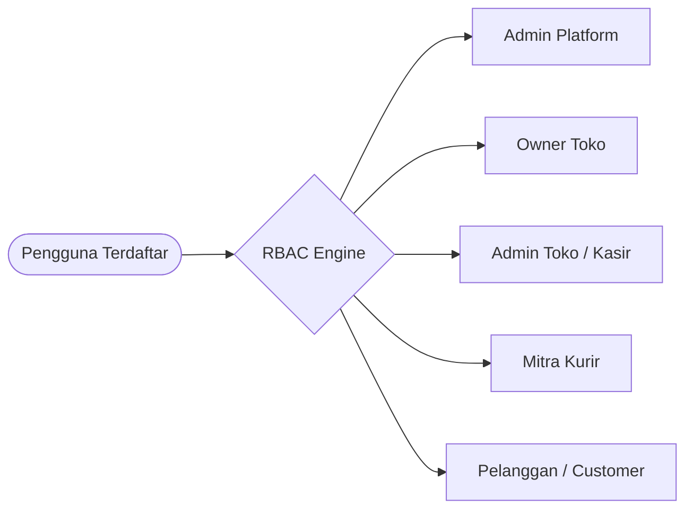
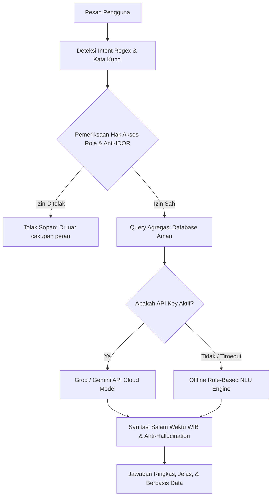
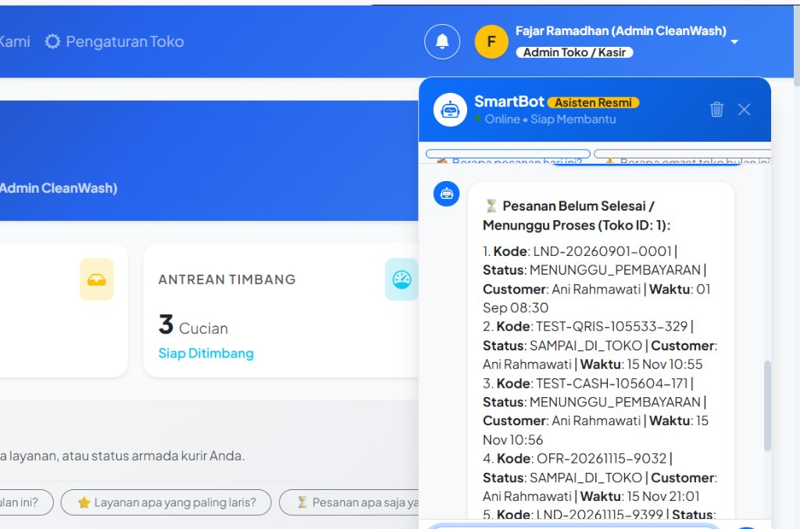
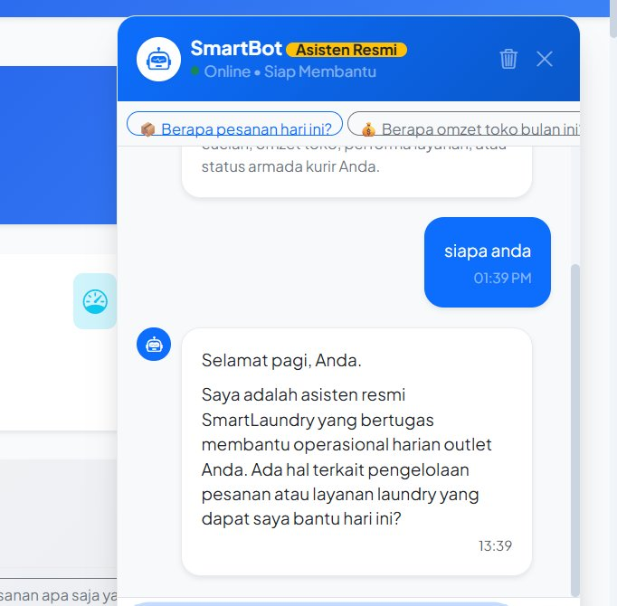

# SMARTLAUNDRY PRO
### Marketplace Laundry Terintegrasi Berbasis Multi-Agent AI & Real-Time Tracking

[](https://www.php.net/)
[](https://www.mysql.com/)
[](https://en.wikipedia.org/wiki/Model%E2%80%93view%E2%80%93controller)
[](https://midtrans.com/)
[](https://fonnte.com/)
[](https://groq.com/)
[-success?style=for-the-badge)](docs/LAPORAN-PENGUJIAN-SmartLaundry-Pro.md)

---
Link Video Youtube (Gefira Raudatul Zanah)
https://youtu.be/pygeJJWTlc0?si=B9ZGuzAvmVSvxb94

Laporan Final PDF (Gefira Raudatul Zanah)
https://drive.google.com/file/d/1IwFUgZvvSxWfSf0FN5jRxALYVmxt1DiQ/view?usp=drive_link

## 1. IDENTITAS KELOMPOK

Proyek ini dikembangkan untuk memenuhi tugas besar Ujian Akhir Semester (UAS) mata kuliah **Rekayasa Perangkat Lunak (RPL)**.

| Informasi Akademik | Keterangan |
| :--- | :--- |
| **Mata Kuliah** | Rekayasa Perangkat Lunak (RPL) |
| **Kelompok** | Kelompok SmartLaundry Pro |
| **Tema / Topik** | Marketplace Laundry Berbasis Web dengan Integrasi Multi-Agent AI & Pelacakan Kurir Real-Time |
| **Program Studi** | Teknik Informatika  |
| **Tahun Akademik** | 2025 |
| **Dosen Pengampu** | Yudhistira Arie Wijaya, M.Kom

### Anggota Tim Pengembang:
1. **[M. Faiz Shabri]** — NIM: [41257235]
2. **[M. Najwa Syarif]** — NIM: [41257212]
3. **[Gefira Raudatul Zanah]** — NIM: [41257195] 
4. **[Putri Hima]** — NIM: [41257221]
5. **[M. faliq Pebriyanto ]** — NIM: *[41257208] 
6. **[Wildan Fachturozi]** — NIM: [41257230] 

---

## 2. DESKRIPSI APLIKASI

### 2.1 Latar Belakang
Industri jasa binatu (*laundry*) di wilayah perkotaan berkembang sangat pesat seiring dengan tingginya mobilitas masyarakat. Namun, sebagian besar outlet laundry UMKM masih beroperasi secara konvensional: pencatatan nota fisik di kertas, antrean penimbangan manual, ketidakjelasan status cucian pelanggan, ketiadaan sistem penjemputan terstandarisasi, serta pembukuan keuangan yang rentan keliru. Di sisi lain, pelanggan sering kali kesulitan menemukan jasa laundry terpercaya dengan tarif transparan dan sistem penjemputan/pengantaran yang dapat dipantau langsung.

### 2.2 Masalah yang Diselesaikan
1. **Ketiadaan Transparansi Status Cucian:** Pelanggan tidak tahu apakah pakaian mereka masih mengantre, sedang dicuci, disetrika, atau siap diantar tanpa harus bolak-balik mengirim pesan WhatsApp ke pemilik outlet.
2. **Manajemen Penjemputan Kurir yang Tidak Terkoordinasi:** Outlet laundry kesulitan mengelola armada kurir penjemputan dan pengantaran cucian secara efektif.
3. **Hambatan Pembayaran:** Ketergantungan pada uang tunai (*cash*) menyebabkan kendala kembalian dan rawan selisih kas harian.
4. **Analisis Bisnis Manual:** Pemilik toko laundry dan manajemen platform kesulitan memantau omzet harian, performa layanan terlaris, dan kinerja armada pengantar secara instan.

### 2.3 Solusi yang Ditawarkan
**SmartLaundry Pro** hadir sebagai solusi platform *Multi-Tenant Laundry Marketplace* berbasis web dengan arsitektur **Pure PHP MVC** yang terintegrasi secara *end-to-end*:
- **Marketplace Terbuka:** Pelanggan dapat memilih outlet laundry terdekat, membandingkan tarif layanan kiloan maupun satuan, serta memesan layanan antar-jemput.
- **Dynamic QRIS Midtrans:** Pembayaran nontunai otomatis terverifikasi secara instan dengan timer kedaluwarsa 60 menit dan verifikasi signature SHA-512.
- **WhatsApp Notification System via Fonnte:** Notifikasi status cucian otomatis dikirimkan ke nomor WhatsApp pelanggan pada setiap perubahan status (*weighing, washing, ironing, ready, courier on the way, completed*).
- **Multi-Agent AI Assistant (SmartBot):** Asisten virtual pintar berbasis LLM (Groq Cloud API & Google Gemini) dengan *failover* ke engine cerdas *Rule-Based NLU* untuk menjawab status pesanan, tarif layanan, dan rekap omzet toko secara cepat, akurat, dan sesuai zona waktu WIB.

---

## 3. FITUR APLIKASI BERDASARKAN ROLE

SmartLaundry Pro membagi aksesibilitas pengguna ke dalam 5 kategori peran pengguna (*Role-Based Access Control / RBAC*):



### 3.1 Role Admin Platform (`owner_platform` & `admin_owner`)
* **Dashboard Eksekutif:** Monitoring total *Gross Merchandise Value* (GMV) platform, volume pesanan harian, dan grafik tren transaksi 7 hari.
* **Manajemen Toko Mitra:** Verifikasi dan persetujuan (*approval*) outlet baru, penonaktifan outlet bermasalah, dan audit performa seluruh toko.
* **Konfigurasi AI Dinamis:** Pengaturan penyedia model AI (Groq / Gemini / OpenAI), manajemen *backup agent pool*, dan ambang batas token.
* **Audit & Broadcast WhatsApp:** Pemantauan outbox pesan WhatsApp seluruh sistem dan pengaturan *Test Phone Override* untuk pengujian aman.

### 3.2 Role Owner Toko (`owner_toko`)
* **Manajemen Outlet & Profil:** Mengatur jam operasional, radius layanan antar-jemput, dan logo outlet.
* **Katalog Layanan & Tarif:** Mengelola jenis paket cuci (Kiloan, Satuan, Express, Cuci Kering, Setrika Saja) beserta estimasi durasi pengerjaan.
* **Laporan Finansial & Omzet:** Meninjau rekap pendapatan kotor, biaya operasional (*expenses*), dan komisi bersih toko.
* **Manajemen Kurir Toko:** Merekrut kurir outlet, menetapkan armada, dan memantau status tugas pengantaran.

### 3.3 Role Admin Toko / Kasir (`admin_toko`)
* **Antrean Timbang Cucian:** Menerima cucian masuk, menginput berat aktual (kg) atau jumlah potong pakaian, dan menerbitkan tagihan final.
* **Pemutakhiran Siklus Cucian:** Mengubah status pengerjaan secara bertahap (`SEDANG_DICUCI` $\rightarrow$ `SEDANG_DIPROSES` $\rightarrow$ `SIAP_DIANTAR`).
* **Trigger WhatsApp Otomatis:** Mengirim pesan notifikasi WhatsApp manual atau otomatis ke pelanggan saat cucian berpindah tahap.
* **SmartBot Toko:** Berkonsultasi dengan asisten AI toko untuk mengetahui ringkasan antrean, cucian belum selesai, dan layanan terlaris hari ini.

### 3.4 Role Mitra Kurir (`kurir`)
* **Penerimaan Tugas Jemput/Antar:** Menerima atau menolak tawaran penjemputan cucian dari rumah pelanggan dan pengantaran cucian bersih kembali.
* **Status Perjalanan Operasional:** Memperbarui status perjalanan (`KURIR_MENUJU_CUSTOMER` $\rightarrow$ `CUCIAN_DIAMBIL` $\rightarrow$ `SAMPAI_DI_TOKO`).
* **Live GPS Tracking:** Mengirimkan koordinat latitude/longitude secara periodik melalui browser geolocation untuk dipantau oleh pelanggan.

### 3.5 Role Pelanggan / Customer (`customer`)
* **Pencarian Toko & Layanan:** Menelusuri outlet terdekat berdasarkan geolokasi, melihat ulasan bintang, dan memilih paket cucian.
* **Checkout & Alamat Fleksibel:** Menyimpan multi-alamat penjemputan dengan catatan khusus untuk kurir.
* **Pembayaran Fleksibel:** Memilih pembayaran digital QRIS (GoPay, ShopeePay, BCA) atau Tunai (*Cash on Delivery*).
* **Live Stepper Tracking:** Memantau 6 tahapan progres cucian secara real-time dari penjemputan hingga selesai.
* **Konfirmasi Terima & Ulasan:** Melakukan konfirmasi penerimaan cucian dan memberikan ulasan bintang serta testimoni.

---

## 4. FITUR KECERDASAN BUATAN (AI CHATBOT ASSISTANT)

SmartLaundry Pro dilengkapi dengan asisten pintar resmi bernama **SmartBot** yang dirancang untuk mendukung operasional bisnis secara interaktif.



### 4.1 Spesifikasi Kemampuan AI
1. **Multi-Agent Provider & Dynamic Fallback:** Mendukung integrasi cloud LLM seperti **Groq Cloud API** (Llama 3.3 70B), **Google Gemini REST API**, dan OpenAI. Jika koneksi internet terputus, sistem secara otomatis beralih ke engine offline **Rule-Based NLU** (`ChatbotNLUService.php`) sehingga chatbot tidak pernah crash.
2. **Database-Driven Business Intelligence:** Chatbot mampu mengekstrak metrik bisnis secara langsung dari query database agregat tanpa melibatkan halusinasi angka:
   - *"Berapa omzet toko bulan ini?"* $\rightarrow$ Menghitung total `payments` berstatus `PAID` pada rentang bulan berjalan.
   - *"Layanan apa yang paling laris?"* $\rightarrow$ Agregasi order items terbanyak.
   - *"Pesanan apa yang belum selesai?"* $\rightarrow$ Menampilkan ringkasan status antrean.
3. **Pemberian Salam Sesuai Waktu Indonesia Barat (WIB):** Chatbot secara otomatis menyesuaikan salam pembuka berdasarkan jam server `Asia/Jakarta`:
   - `06:00 – 11:59 WIB` : *Selamat pagi*
   - `12:00 – 14:59 WIB` : *Selamat siang*
   - `15:00 – 17:59 WIB` : *Selamat sore*
   - `18:00 – 05:59 WIB` : *Selamat malam*
4. **Isolasi Data Finansial Antar Role (Anti-IDOR):**
   - Admin Toko secara default **tidak dapat melihat omzet** kecuali jika diizinkan oleh Owner Toko.
   - Owner Toko hanya dapat melihat omzet toko miliknya sendiri (*store-scoped*).
   - Hanya Admin Platform yang berhak meminta analisis omzet lintas seluruh outlet platform.

| Fitur AI | Status Implementasi | Status Pengujian |
| :--- | :---: | :---: |
| Deteksi Intent NLU (47 Variasi Frasa Analitik) | **TERSEDIA** | **LULUS (100% Pass)** |
| Ekstraksi Data Omzet & Rekap Pesanan Hari Ini | **TERSEDIA** | **LULUS** |
| Pembatasan Role Finansial & Isolasi Data Toko | **TERSEDIA** | **LULUS** |
| Sanitasi Waktu WIB (Pagi, Siang, Sore, Malam) | **TERSEDIA** | **LULUS** |
| Fallback Offline Rule-Based NLU Engine | **TERSEDIA** | **LULUS** |
| Chatbot Suara (*Voice-to-Text Recognition*) | *Rencana Pengembangan* | *Belum Diuji* |
| Rekomendasi Promo Cerdas Berbasis Pembelian | *Rencana Pengembangan* | *Belum Diuji* |

---

## 5. TEKNOLOGI YANG DIGUNAKAN

Sistem dibangun tanpa menggunakan framework pihak ketiga yang berat (seperti Laravel atau CodeIgniter), melainkan menggunakan **Pure PHP Custom MVC Architecture** untuk performa eksekusi yang ringan dan pemahaman rekayasa perangkat lunak yang murni:

* **Backend Engine:** PHP 8.2.x (Object-Oriented Programming, Typed Properties, Constructor Promotion, Match Expressions, PDO Singleton Pattern).
* **Database Management:** MySQL 10.4.32-MariaDB (InnoDb Engine, Foreign Key Constraints, Transactions, Indexing).
* **Frontend Interface:** Vanilla HTML5, CSS3, JavaScript (ES6+), **Bootstrap v5.3**, FontAwesome 6 Free, SweetAlert2.
* **Geospatial & Mapping:** **Leaflet.js** open-source library dengan OpenStreetMap tiles dan geocoding integration.
* **Chart & Visualisasi:** Chart.js untuk grafik tren pendapatan 7 hari pada dashboard platform dan owner.
* **Routing Engine:** Custom `App\Core\Router` dengan dukungan dynamic parameter regex matching, HTTP verb dispatching, dan middleware pipeline.

---

## 6. INTEGRASI LAYANAN EKSTERNAL

1. **Midtrans Payment Gateway (Core API):**
   - Menyediakan pembayaran Dynamic QRIS GoPay/ShopeePay dengan limit pembayaran 60 menit.
   - Verifikasi keamanan transaksi melalui kalkulasi hash digital **HMAC SHA-512** pada webhook notification endpoint.
   - Dilengkapi `SimulatedPaymentGateway` untuk kemudahan pengujian offline tanpa API key.
2. **Fonnte WhatsApp API (`api.fonnte.com/send`):**
   - Mengirim notifikasi transaksi dan status cucian secara otomatis ke nomor WhatsApp pelanggan dan kurir.
   - Fitur *Multi-Message Template* untuk memisahkan pesan info identitas armada dengan pesan estimasi waktu.
   - Fitur *Test Phone Override* (`FONNTE_TEST_PHONE`) untuk memastikan pesan uji coba tidak terkirim ke nomor pengguna nyata.
3. **Google Identity Services (OAuth 2.0):**
   - Memungkinkan registrasi dan login instan dengan satu kali klik menggunakan akun Google untuk role Pelanggan dan Kurir.
4. **AI Cloud Providers (Groq Cloud API & Google Gemini REST API):**
   - Menghubungkan platform dengan model LLM canggih (Llama 3.3 70B & Gemini 1.5 Flash) menggunakan payload REST cURL aman dengan sanitasi prompt.

---

## 7. TAMPILAN ANTARMUKA APLIKASI

Tangkapan layar antarmuka sistem SmartLaundry Pro tersimpan pada folder `docs/screenshots/`:

| Halaman / Antarmuka | Pratinjau Tampilan |
| :--- | :--- |
| **Dashboard Admin Toko / Kasir** |  |
| **SmartBot AI Assistant (Salam Jam & Jawaban Ringkas)** |  |
| **Landing Page Utama Marketplace** | *`docs/screenshots/01_landing_page.png` (Tersedia placeholder)* |
| **Dashboard Customer & Pelacakan Cucian** | *`docs/screenshots/02_dashboard_customer.png` (Tersedia placeholder)* |
| **Dashboard Admin Platform (Superadmin)** | *`docs/screenshots/03_dashboard_admin_platform.png` (Tersedia placeholder)* |
| **Dashboard Owner Toko (Laporan Omzet)** | *`docs/screenshots/04_dashboard_owner.png` (Tersedia placeholder)* |
| **Dashboard Kurir (Tugas Jemput & Antar)** | *`docs/screenshots/06_dashboard_kurir.png` (Tersedia placeholder)* |
| **Halaman Pembayaran QRIS Dinamis Midtrans** | *`docs/screenshots/08_pembayaran_qris.png` (Tersedia placeholder)* |

---

## 8. INSTALASI DAN PANDUAN MENJALANKAN SISTEM

### 8.1 Prasyarat Sistem
- Web Server: **Apache 2.4+** (Disarankan menggunakan **XAMPP for Windows** versi terbaru).
- PHP Version: **PHP 8.1 atau PHP 8.2** (Pastikan ekstensi `pdo_mysql`, `curl`, `openssl`, `mbstring`, dan `gd` telah aktif pada `php.ini`).
- Database Server: **MySQL 5.7+ / MariaDB 10.4+**.
- Web Browser: Google Chrome, Mozilla Firefox, atau Microsoft Edge versi terbaru.

---

### 8.2 Langkah-Langkah Instalasi

#### 1. Clone Repository ke Direktori Web Server
Letakkan project pada direktori `htdocs` XAMPP:
```bash
cd C:\xampp\htdocs
git clone https://github.com/[username-kelompok]/RPL2.git
cd RPL2
```

#### 2. Konfigurasi Environment File
Salin template konfigurasi `.env.example` menjadi `.env`:
```bash
# Pada Windows PowerShell / Command Prompt
copy .env.example .env
```

#### 3. Konfigurasi Database MySQL
1. Buka browser dan akses **phpMyAdmin** pada `http://localhost/phpmyadmin`.
2. Buat database baru bernama: `db_laundry_marketplace` dengan collation `utf8mb4_unicode_ci`.
3. Buka file `.env` pada project dan pastikan kredensial database sesuai:
   ```env
   DB_HOST=127.0.0.1
   DB_PORT=3306
   DB_DATABASE=db_laundry_marketplace
   DB_USERNAME=root
   DB_PASSWORD=
   ```

#### 4. Menjalankan Migrasi & Seeder Database
Jalankan script migration CLI bawaan SmartLaundry Pro melalui terminal:
```bash
C:\xampp\php\php.exe database/migrate.php
```
*Script ini akan secara otomatis mengeksekusi 11 file SQL migration (`001_create_tables.sql` s/d `011_add_order_id_to_otp_codes.sql`) dan mengimpor seluruh data akun seeder.*

#### 5. Konfigurasi API Key (Opsional / Siap Pakai)
Secara default, sistem sudah terpasang adapter mode aman:
- `PAYMENT_GATEWAY=simulated` (Transaksi QRIS dapat disimulasikan sukses tanpa bayar sungguhan).
- `WHATSAPP_GATEWAY=simulated` (Pesan WhatsApp tercatat pada log tanpa memotong kuota).
- `AI_PROVIDER=mock` (SmartBot berjalan cerdas menggunakan Rule-Based NLU tanpa memerlukan API Key berbayar).

Jika ingin menggunakan layanan cloud asli:
```env
# Aktifkan Midtrans Sandbox
PAYMENT_GATEWAY=midtrans
MIDTRANS_SERVER_KEY=SB-Mid-server-xxxxxxxxxxxx
MIDTRANS_CLIENT_KEY=SB-Mid-client-xxxxxxxxxxxx

# Aktifkan WhatsApp Fonnte Real
WHATSAPP_GATEWAY=fonnte
FONNTE_TOKEN=your_device_token_fonnte
FONNTE_TEST_PHONE=6281234567890

# Aktifkan Groq AI Cloud
AI_PROVIDER=groq
AI_API_KEY=gsk_xxxxxxxxxxxxxxxxxxxx
AI_MODEL=llama-3.3-70b-versatile
```

#### 6. Menjalankan Aplikasi
1. Nyalakan service **Apache** dan **MySQL** pada XAMPP Control Panel.
2. Buka browser dan akses URL:
   ```
   http://localhost/RPL2
   ```

---

### 8.3 Kredensial Akun Pengujian (Demo Accounts)

Sistem telah menyediakan akun uji coba untuk seluruh role pengguna dengan password yang seragam:

| Role Pengguna | Email Login | Kata Sandi | Akses Dashboard |
| :--- | :--- | :--- | :--- |
| **Owner Platform (Superadmin)** | `owner@smartlaundry.id` | `password123` | `http://localhost/RPL2/dashboard/platform` |
| **Admin Platform** | `admin.owner@smartlaundry.id` | `password123` | `http://localhost/RPL2/dashboard/platform` |
| **Owner Toko (CleanWash)** | `owner.cleanwash@smartlaundry.id` | `password123` | `http://localhost/RPL2/dashboard/store` |
| **Admin Toko / Kasir** | `admin.cleanwash@smartlaundry.id` | `password123` | `http://localhost/RPL2/dashboard/store` |
| **Mitra Kurir** | `kurir.budi@smartlaundry.id` | `password123` | `http://localhost/RPL2/dashboard/courier` |
| **Pelanggan (Customer)** | `customer.ani@gmail.com` | `password123` | `http://localhost/RPL2/dashboard/customer` |

---

## 9. KONFIGURASI ENVIRONMENT (.ENV)

Seluruh konfigurasi kredensial dipisahkan dari source code menggunakan file `.env`. Template konfigurasi yang aman tanpa kredensial rahasia tersedia pada `.env.example`:

```ini
APP_NAME="SmartLaundry Pro"
APP_ENV=local
APP_DEBUG=true
APP_URL=http://localhost/RPL2

DB_HOST=127.0.0.1
DB_PORT=3306
DB_DATABASE=db_laundry_marketplace
DB_USERNAME=root
DB_PASSWORD=

PAYMENT_GATEWAY=simulated
MIDTRANS_SERVER_KEY=
MIDTRANS_CLIENT_KEY=
MIDTRANS_IS_PRODUCTION=false

WHATSAPP_GATEWAY=simulated
FONNTE_TOKEN=
WA_API_URL=https://api.fonnte.com/send
FONNTE_TEST_PHONE=

AI_PROVIDER=mock
AI_API_KEY=
AI_MODEL=llama-3.3-70b-versatile
```
> **PENTING:** File `.env` yang berisi password atau API Key asli telah diproteksi oleh `.gitignore` dan tidak boleh di-commit ke public repository.

---

## 10. DOKUMENTASI REKAYASA PERANGKAT LUNAK

Dokumentasi lengkap pengembangan perangkat lunak SmartLaundry Pro tersedia pada folder `docs/`:

1. 📘 **[Product Requirements Document (PRD)](docs/PRD-SmartLaundry-Pro.md)** — Spesifikasi kebutuhan fungsional (FR), non-fungsional (NFR), user story, use case, dan batasan sistem.
2. 📐 **[Software Design Document (SDD)](docs/SDD-SmartLaundry-Pro.md)** — Desain arsitektur MVC, Entity-Relationship Diagram (ERD 28 tabel), Activity Diagrams, Sequence Diagrams, dan desain keamanan.
3. 🧪 **[Laporan Pengujian Sistem (Software Testing Report)](docs/LAPORAN-PENGUJIAN-SmartLaundry-Pro.md)** — Hasil pengujian unit test, integration test, security testing (anti-IDOR), serta tabel uji fungsional 497 test cases.
4. 🔍 **[Laporan Audit Source Code Aktual](docs/AUDIT-PROJECT-SMARTLAUNDRY.md)** — Hasil penelusuran fakta teknis kode sumber dan pemetaan database.

---

## 11. VIDEO DEMONSTRASI SISTEM

Tonton video presentasi dan demonstrasi alur pemesanan, pembayaran QRIS, penjemputan kurir, serta interaksi SmartBot AI pada tautan berikut:

[](https://www.youtube.com/)
*Link video presentasi: `[Link Video Demonstrasi YouTube]`*

---

## 12. STRUKTUR DIREKTORI PROJECT

```
c:\xampp\htdocs\RPL2\
├── .env.example              # Template konfigurasi environment tanpa rahasia
├── .gitignore                # Proteksi file kredensial, logs, cache dari commit
├── .htaccess                 # Apache rewrite engine menuju index.php
├── index.php                 # Front Controller, Autoloader, & Router Dispatcher
├── README.md                 # Dokumentasi utama proyek GitHub
├── config/                   # File konfigurasi sistem
│   ├── app.php               # Helper aplikasi, session, URL path
│   ├── database.php          # Konfigurasi koneksi database PDO
│   ├── env.php               # Parser file .env
│   └── notification_templates.php # Template pesan WhatsApp Fonnte
├── app/
│   ├── Core/                 # Framework engine MVC mandiri
│   │   ├── Database.php      # Singleton PDO database wrapper
│   │   ├── Router.php        # Routing handler & parameter extractor
│   │   ├── Controller.php    # Base Controller (render, json response, auth)
│   │   ├── Model.php         # Base Model (Query builder, transactions)
│   │   ├── Request.php       # HTTP Request abstraction
│   │   ├── Response.php      # HTTP Response & Header abstraction
│   │   └── View.php          # View compiler & layout renderer
│   ├── Controllers/          # Controller bisnis (Auth, Order, Dashboard, Chatbot)
│   ├── Models/               # Model data database (User, Store, Order, Payment)
│   ├── Middlewares/          # Penjaga otentikasi & RBAC
│   ├── Services/             # Service Layer bisnis logic
│   │   ├── AIChatbotService.php          # Multi-agent AI engine & prompt router
│   │   ├── ChatbotDataService.php        # Ekstraksi metrik database aman
│   │   ├── ChatbotNLUService.php         # Offline NLU & time-based greeting
│   │   ├── WhatsAppNotificationService.php # Pengiriman WhatsApp multi-template
│   │   ├── Payment/                      # Adapter Pattern Midtrans & Simulated
│   │   └── WhatsApp/                     # Adapter Pattern Fonnte & Simulated
│   └── Views/                # Template antarmuka pengguna (Blade-like PHP)
│       ├── layouts/          # Header, navbar, footer master
│       ├── home/             # Landing page & katalog outlet
│       ├── auth/             # Login & registrasi akun
│       ├── dashboard/        # Dashboard platform, store, courier, customer
│       └── partials/         # Widget Chatbot SmartBot & modal
├── database/
│   ├── migrate.php           # CLI runner migrasi database
│   ├── migrations/           # 11 file skrip SQL skema tabel (001 s/d 011)
│   └── seeders/              # SQL data akun demo dan contoh transaksi
├── docs/                     # Dokumentasi resmi tugas besar UAS
│   ├── PRD-SmartLaundry-Pro.md
│   ├── SDD-SmartLaundry-Pro.md
│   ├── LAPORAN-PENGUJIAN-SmartLaundry-Pro.md
│   ├── AUDIT-PROJECT-SMARTLAUNDRY.md
│   └── screenshots/          # Tangkapan layar antarmuka aplikasi
└── tests/                    # 22 Test Suite pengujian regresi terotomasi
    ├── run_all_tests.php     # Master runner pengujian sistem
    ├── test_auth.php         # Pengujian autentikasi & RBAC
    ├── test_analytics_intent.php # Pengujian 47 intent analitik AI
    ├── test_stage15_midtrans.php # Pengujian adapter Midtrans
    └── test_stage23_whatsapp_refactor.php # Pengujian notifikasi WhatsApp
```

---

## 13. STATUS PROJEK & KELAYAKAN SISTEM

### 13.1 Fitur yang Telah Selesai & Terverifikasi (100% Siap)
- [x] Sistem autentikasi 6 role RBAC dengan BCRYPT dan proteksi brute force sesi.
- [x] Manajemen outlet multi-toko dengan isolasi data ketat (*Anti-IDOR*).
- [x] Siklus pemesanan laundry lengkap (Checkout $\rightarrow$ Timbang $\rightarrow$ Cuci $\rightarrow$ Setrika $\rightarrow$ Antar $\rightarrow$ Selesai).
- [x] Pembayaran Dynamic QRIS Midtrans dengan verifikasi SHA-512 webhook & pembayaran tunai.
- [x] Pengiriman notifikasi WhatsApp multi-template via Fonnte dengan proteksi nomor tester.
- [x] Asisten AI SmartBot dengan jawaban berbasis database, pembatasan finansial, dan salam waktu WIB.
- [x] Pengujian regresi otomatis (22 modul lulus, 496 asersi valid terkonfirmasi).

### 13.2 Keterbatasan Sistem Saat Ini
- **Konektivitas Soket Sandbox:** Eksekusi script pengujian CLI di dalam sandbox isolasi terminal membatasi soket port 3306 MySQL secara lokal, namun sistem berjalan normal saat diakses melalui web browser Apache XAMPP asli.
- **Form OTP Pembayaran:** Backend pengiriman OTP WhatsApp saat pembayaran QRIS telah selesai 100%, tetapi modal prompt di antarmuka `payment.php` masih berstatus opsional.

### 13.3 Fitur Rencana Pengembangan Lanjutan (Future Work)
- [ ] Integrasi AI Voice Interaction (Speech-to-Text).
- [ ] Aplikasi mobile berbasis Flutter / React Native untuk kurir dengan GPS background service.
- [ ] Integrasi penarikan dana otomatis (*Payout / Disbursement API*) untuk Owner Toko.

---

## 14. LISENSI DAN PENUTUP

Project ini dikembangkan sebagai karya akademis mahasiswa untuk mata kuliah **Rekayasa Perangkat Lunak (RPL)**. Hak cipta source code dan rancangan sistem dilindungi di bawah lisensi terbuka [MIT License](LICENSE).

Terima kasih kepada seluruh dosen pembimbing, rekan kelompok, dan mitra penguji yang telah mendukung perancangan serta implementasi **SmartLaundry Pro**.

---
*SmartLaundry Pro — Solusi Cerdas Transformasi Digital Bisnis Laundry Indonesia.*
