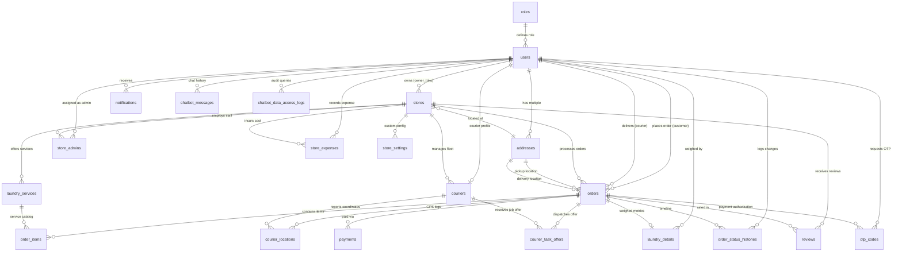

# LAPORAN AUDIT SISTEM MENYELURUH (COMPREHENSIVE SYSTEM AUDIT)
## SMARTLAUNDRY PRO — MARKETPLACE LAUNDRY BERBASIS AI

> **Tujuan Dokumen**: Laporan audit teknis dan arsitektural menyeluruh untuk pemenuhan evaluasi tugas Ujian Akhir Semester (UAS) Rekayasa Perangkat Lunak (RPL).  
> **Tanggal Audit**: 17 November 2026  
> **Auditor**: Senior Software Architect, Backend Engineer & Software Quality Assurance  
> **Workspace**: `c:\xampp\htdocs\RPL2`  
> **Metode Audit**: Pemeriksaan kode statis (Static Code Analysis), Verifikasi Skema & Relasi Database, Pemeriksaan Routing & Controller, Analisis Keamanan RBAC & IDOR, Pengujian Regresi Otomatis (Regression Test Suite), dan Pemeriksaan Syntax PHP CLI.

---

## DAFTAR ISI
1. [A. Identifikasi Project](#a-identifikasi-project)
2. [B. Audit Seluruh Role Pengguna (RBAC)](#b-audit-seluruh-role-pengguna-rbac)
3. [C. Audit Fitur Aplikasi](#c-audit-fitur-aplikasi)
4. [D. Audit Database & Diagram ERD](#d-audit-database--diagram-erd)
5. [E. Audit Sistem Kecerdasan Buatan (AI Engine)](#e-audit-sistem-kecerdasan-buatan-ai-engine)
6. [F. Audit Pengujian & Kualitas Perangkat Lunak](#f-audit-pengujian--kualitas-perangkat-lunak)
7. [G. Tabel Matriks Fitur, Implementasi & Status Pengujian](#g-tabel-matriks-fitur-implementasi--status-pengujian)
8. [H. Temuan Kekurangan & Rekomendasi Sebelum Pengumpulan UAS](#h-temuan-kekurangan--rekomendasi-sebelum-pengumpulan-uas)

---

## A. IDENTIFIKASI PROJECT

| Parameter | Detail Temuan Audit |
|---|---|
| **Nama Aplikasi** | **SmartLaundry Pro** (di codebase dikenal juga sebagai *SmartLaundry AI Marketplace*) |
| **Deskripsi & Tujuan** | Aplikasi marketplace laundry multi-tenant berbasis web yang menghubungkan 5 entitas pengguna: Pengelola Platform, Pemilik Toko Laundry, Operator/Kasir Toko, Armada Kurir Penjemput/Pengantar, dan Pelanggan. Dilengkapi asisten virtual berbasis AI (SmartBot), pelacakan kurir GPS real-time, otomatisasi notifikasi WhatsApp via Fonnte Gateway, dan pembayaran digital QRIS Midtrans dengan batas waktu otomatis 60 menit. |
| **Bahasa Pemrograman** | **PHP 8.0+** (diuji dan berjalan pada PHP 8.2.12 CLI / Apache module) |
| **Framework & Engine** | **Custom Lightweight MVC Framework** (Murni PHP tanpa Laravel/CodeIgniter/Symfony). Memiliki komponen Core mandiri: Singleton PDO Database, RegEx Route Dispatcher, Base Controller dengan view & JSON helper, Active Record/Query Builder Model, HTTP Request & Response Wrapper. |
| **Library Frontend** | **Bootstrap 5.3+**, Bootstrap Icons, Google Fonts (*Plus Jakarta Sans*), Leaflet.js / OpenStreetMap untuk peta interaktif pelacakan kurir. |
| **Library Backend & Driver** | Native PHP cURL (Midtrans Core API, Fonnte REST API, Google Gemini API, Groq Cloud API, OpenAI API), PDO MySQL Driver. |
| **Database Engine** | **MySQL 5.7+ / MariaDB 10.4+** (InnoDB Engine, utf8mb4_unicode_ci) |
| **Total Tabel Database** | **28 Tabel** (terstruktur dalam 11 file migrasi SQL berurutan) |
| **Arsitektur Aplikasi** | **Model-View-Controller (MVC) + Service Layer Architecture**. Controller menangani alur HTTP, Model menangani persistensi data, Service Layer menangani integrasi pihak ketiga (AI, WhatsApp, Maps, Payment Gateway, Platform Analytics), dan Middleware menangani otentikasi serta otorisasi RBAC. |

### Struktur Folder Project Aktual

```
c:\xampp\htdocs\RPL2\
├── .env                              # Konfigurasi aktif environment (DB, API Keys, App Key)
├── .env.example                      # Template konfigurasi environment
├── .htaccess                         # Apache rewrite engine menuju index.php
├── index.php                         # Front Controller, Autoloader PSR-4, Global Exception Handler
├── README.md                         # Dokumentasi umum sistem
├── patch.php                         # Arsip utilitas migrasi lama
├── cron_autocomplete_delivered_orders.php # Background cron auto-complete order 24 jam
├── cron_check_expired_payments.php   # Background cron kadaluarsa pembayaran QRIS
├── cron_purge_chatbot_logs.php       # Background cron retensi pesan chatbot
├── config/                           # Konfigurasi aplikasi
│   ├── app.php                       # Konstanta aplikasi, helper fungsi, session, URL
│   ├── database.php                  # Parameter koneksi database PDO
│   ├── env.php                       # Parser manual file .env
│   ├── metrics_catalog.php           # Katalog metrik analitik platform & toko
│   ├── metrics_access.php            # Matriks izin akses metrik berbasis role
│   ├── notification_templates.php    # Template pesan WhatsApp default
│   └── chatbot_schema.php            # Skema basis pengetahuan chatbot
├── app/
│   ├── Core/                         # Engine MVC Inti
│   │   ├── Controller.php            # Base controller (render, json, auth, CSRF)
│   │   ├── Database.php              # Singleton PDO database connector
│   │   ├── Model.php                 # Base model ORM (CRUD, prepared statements, transactions)
│   │   ├── Request.php               # Abstraksi HTTP request (GET, POST, JSON body, Header, Files)
│   │   ├── Response.php              # Abstraksi HTTP response (status code, JSON, redirect)
│   │   ├── Router.php                # Dispatcher route dinamis dengan regex parameter matching
│   │   └── View.php                  # View layout rendering engine
│   ├── Controllers/                  # 24 Controller fitur aplikasi
│   ├── Models/                       # 20 Model database entitas
│   ├── Middlewares/                  # AuthMiddleware, GuestMiddleware, RoleMiddleware
│   ├── Services/                     # Business Logic & Third-Party Service Adapters
│   │   ├── AIChatbotService.php      # Engine orkestrator Chatbot Multi-Provider & Fallback
│   │   ├── ChatbotDataService.php    # Query analitik aman, read-only & anti-IDOR
│   │   ├── ChatbotNLUService.php     # Natural Language Understanding & Time-based Greeting
│   │   ├── WhatsAppNotificationService.php # Service pengiriman pesan WhatsApp multi-kategori
│   │   ├── PlatformStatsService.php  # Service kalkulasi statistik platform
│   │   ├── MetricsService.php        # Service perhitungan metrik operasional & keuangan
│   │   ├── Maps/                     # Google Maps & Geocoding Service Adapter
│   │   ├── Payment/                  # Midtrans & Simulated Payment Gateway
│   │   └── WhatsApp/                 # Fonnte & Simulated WhatsApp Gateway + cURL Transport
│   └── Views/                        # 46 File antarmuka pengguna (Blade-like PHP Views)
├── database/
│   ├── migrate.php                   # CLI migration runner
│   ├── migrations/                   # 11 File migrasi SQL (001 s/d 011)
│   └── seeders/                      # Dummy data seeder (seed_dummy_data.sql & SettingSeeder.php)
├── docs/                             # Dokumentasi teknis, ERD, dan Deployment
├── storage/logs/                     # Log runtime: error.log, chatbot.log, whatsapp.log
└── tests/                            # 26 File skrip pengujian regresi resmi
```

### Cara Menjalankan Aplikasi
1. Nyalakan service **Apache** dan **MySQL** melalui XAMPP Control Panel.
2. Pastikan file `.env` telah mengarah ke database yang benar:
   ```ini
   DB_HOST=127.0.0.1
   DB_PORT=3306
   DB_DATABASE=db_laundry_marketplace
   DB_USERNAME=root
   DB_PASSWORD=
   ```
3. Eksekusi skrip migrasi dan seeder awal (jika belum dijalankan):
   ```bash
   C:\xampp\php\php.exe database/migrate.php
   ```
4. Buka browser pada URL: `http://localhost/RPL2/` (atau `http://localhost/RPL2/public/`).
5. Masuk melalui halaman `/login` menggunakan salah satu akun demo yang telah disediakan.

---

## B. AUDIT SELURUH ROLE PENGGUNA (RBAC)

Sistem mengimplementasikan **Role-Based Access Control (RBAC)** ketat di tingkat middleware (`App\Middlewares\RoleMiddleware`) dan query database scoping. Terdapat 6 role pengguna yang terdaftar pada tabel `roles`:

### 1. Admin Platform (`owner_platform` & `admin_owner`)
* **Pengguna Demo**:
  - `owner@smartlaundry.id` (Bambang Sudirgo — Super Owner / Platform Owner)
  - `admin.owner@smartlaundry.id` (Rina Wijaya — Admin Platform)
* **Dashboard Utama**: `/dashboard/platform`
* **Hak Akses & Fitur**:
  - Memantau metrik global seluruh platform: Gross Merchandise Value (GMV), total pendapatan, komisi platform, jumlah toko aktif/terdaftar, volume cucian, dan total pelanggan.
  - Verifikasi dan aktivasi kemitraan toko laundry baru (`POST /platform/stores/{id}/toggle-verify`).
  - Manajemen pengaturan platform global (`GET|POST /platform/settings`), termasuk mode maintenance sistem.
  - Manajemen integrasi AI & model cadangan (Backup Agent Pool): tambah model, uji koneksi, aktifkan, hapus, dan promosi model utama (`/platform/settings/ai-models/*`).
  - Pengelolaan Basis Pengetahuan AI (*Chatbot Knowledge Base*) (`/platform/settings/knowledge/*`).
  - Pemantauan Outbox Log WhatsApp global dan pengujian gateway Fonnte (`/platform/whatsapp-settings`).
  - Pemantauan dan audit log percakapan AI (*Chatbot Logs Audit Trail*) beserta ekspor data (`/platform/chatbot-logs/*`).
  - Mengakses Asisten AI Platform dengan kewenangan data analitik agregat lintas seluruh toko.

### 2. Owner Toko (`owner_toko`)
* **Pengguna Demo**:
  - `owner.cleanwash@smartlaundry.id` (Hendra Kurniawan — Owner CleanWash)
  - `owner.freshsoft@smartlaundry.id` (Dewi Lestari — Owner FreshSoft)
* **Dashboard Utama**: `/dashboard/store`
* **Hak Akses & Fitur**:
  - Pengelolaan Profil Outlet: nama outlet, deskripsi, alamat, kontak WhatsApp, jam operasional, upload banner dan logo (`GET|POST /store/profile`).
  - Manajemen Katalog Layanan Toko: tambah layanan kiloan/satuan, setel harga, min order, durasi pengerjaan, aktifkan/nonaktifkan layanan (`/store/services/*`).
  - Manajemen Armada Kurir Toko: tambah akun kurir, ubah nomor kendaraan/plat motor, reset status (`/store/couriers/*`).
  - Manajemen Beban Operasional Toko (*Store Expenses*): mencatat biaya deterjen, listrik, sewa, gaji karyawan (`GET|POST /store/expenses`).
  - Laporan Keuangan Toko: omzet bulanan, jumlah transaksi sukses, laba kotor, dan riwayat pesanan toko.
  - Persetujuan Pembatalan & Pengembalian Cucian (*Refund & Return Approval*) (`/store/refunds/*`).
  - Pengaturan Notifikasi WhatsApp Toko & Pengujian Mode Override (`/store/whatsapp-settings`).
  - Asisten AI Toko (*Store SmartBot*) khusus membaca data toko sendiri (pesanan, keuangan, kurir, pelanggan).

### 3. Admin Toko / Kasir (`admin_toko`)
* **Pengguna Demo**:
  - `admin.cleanwash@smartlaundry.id` (Fajar Ramadhan — Admin CleanWash)
  - `admin.freshsoft@smartlaundry.id` (Maya Anggraini — Admin FreshSoft)
* **Dashboard Utama**: `/dashboard/store` (tampilan disesuaikan untuk operasional toko)
* **Hak Akses & Fitur**:
  - Konfirmasi Penerimaan / Penolakan Pesanan Masuk (`/store/orders/{id}/accept|reject`).
  - Penimbangan Laundry: input berat riil (kg), jumlah item, dan kalkulasi tagihan otomatis (`POST /store/orders/{id}/weigh`).
  - Konfirmasi Pembayaran Tunai (Cash) di kasir (`POST /store/orders/{id}/confirm-payment`).
  - Pembaruan Status Proses Laundry: pencucian (`SEDANG_DICUCI`), setrika/packing (`SEDANG_DIPROSES`), siap antar (`SIAP_DIANTAR`), hingga selesai (`SELESAI`).
  - Penugasan Kurir Toko Manual (*Manual Assign Courier*) (`POST /store/orders/{id}/manual-assign-courier`).
  - Trigger Pengiriman Ulang WhatsApp Notifikasi Proses Cucian per tahap (`POST /store/orders/{id}/send-whatsapp`).
  - Akses Asisten AI Toko dibatasi hanya pada antrean operasional (akses keuangan/omzet terkunci secara default sesuai RBAC).

### 4. Kurir (`kurir`)
* **Pengguna Demo**:
  - `kurir.budi@smartlaundry.id` (Budi Santoso — Kurir CleanWash)
  - `kurir.andi@smartlaundry.id` (Andi Pratama — Kurir FreshSoft)
* **Dashboard Utama**: `/dashboard/courier`
* **Hak Akses & Fitur**:
  - Saklar Ketersediaan Kurir: tombol Siap Kerja / Standby vs Offline (`POST /courier/toggle-availability`).
  - Respon Tawaran Tugas: Terima (*Accept*) atau Tolak (*Reject*) tawaran tugas jemput/antar (`/courier/offers/{id}/accept|reject`).
  - Eksekusi Penjemputan (*Pickup Workflow*):
    - Berangkat Menjemput (`POST /courier/orders/{id}/start-pickup`).
    - Konfirmasi Laundry Berhasil Dijemput (`POST /courier/orders/{id}/confirm-picked`).
  - Eksekusi Pengantaran (*Delivery Workflow*):
    - Berangkat Mengantar ke Pelanggan (`POST /courier/orders/{id}/start-delivery`).
    - Konfirmasi Laundry Diterima Pelanggan (`POST /courier/orders/{id}/confirm-delivered`).
  - Pelacakan & Transmisi Koordinat GPS Real-Time ke server (`POST /courier/location/update`).
  - Asisten AI Kurir: panduan SOP kurir, urutan alur status jemput/antar, pengecekan tugas aktif.

### 5. Customer / Pelanggan (`customer`)
* **Pengguna Demo**:
  - `customer.ani@gmail.com` (Ani Rahmawati)
  - `customer.deni@gmail.com` (Deni Firmansyah)
  - `customer.siti@gmail.com` (Siti Nurhaliza)
* **Dashboard Utama**: `/dashboard/customer`
* **Hak Akses & Fitur**:
  - Manajemen Alamat Penjemputan/Pengantaran berganda dengan penandaan koordinat latitude/longitude (`/customer/addresses/*`).
  - Jelajah & Pencarian Outlet Laundry Terdekat (`/stores`, `/store/{id}/detail`).
  - Pemesanan Laundry: memilih outlet, memilih layanan kiloan/satuan, memilih alamat jemput/antar, memilih metode pembayaran (Online QRIS atau Cash) (`GET|POST /order/create`).
  - Halaman Tagihan & Pembayaran QRIS Dinamis Midtrans dengan hitung mundur 60 menit (`/order/{id}/payment`).
  - Pelacakan Langsung (*Live Order Tracking*) rute pesanan dan posisi kurir pada peta (`/tracking/{order_code}`).
  - Memberikan ulasan dan rating bintang 1–5 beserta ulasan teks (`/order/{id}/review`).
  - Asisten AI Chatbot Pelanggan: konsultasi tarif, cek status cucian sendiri, bantuan cara memesan dan panduan QRIS.

---

## C. AUDIT FITUR APLIKASI

Berdasarkan audit langsung pada route (`index.php`), Controller, Model, View, dan pengujian aktual:

| Modul Fitur | Bukti File Implementasi | Status Implementasi | Status Pengujian | Analisis & Catatan Faktual |
|---|---|---|---|---|
| **Registrasi Pengguna** | `AuthController.php`, `User.php`, `register.php` | **TERIMPLEMENTASI PENUH** | **DIUJI & LULUS** (`test_auth.php`) | Mendukung pendaftaran role customer dengan validasi email, telepon, dan password hashing BCRYPT. Status awal akun `is_active=0` sebelum verifikasi OTP. |
| **Login Kredensial** | `AuthController.php`, `login.php` | **TERIMPLEMENTASI PENUH** | **DIUJI & LULUS** (`test_auth.php`) | Menggunakan `password_verify()`. Mencegah brute-force dengan redirection otomatis berbasis role pengguna. |
| **Google OAuth** | `AuthController.php` (`googleAuth`), `login.php` | **TERIMPLEMENTASI (DUAL MODE)** | **DIUJI & LULUS** (`test_auth.php`) | Jika `GOOGLE_CLIENT_ID` terisi, redirect ke Google OAuth v2 API. Jika kosong di `.env`, otomatis beralih ke Sandbox Simulated OAuth untuk demo pengujian. |
| **Manajemen Toko** | `StoreProfileController.php`, `Store.php`, `store/profile.php` | **TERIMPLEMENTASI PENUH** | **DIUJI & LULUS** (`test_stage5_and_audit.php`) | Pengelolaan profil toko, upload media gambar (banner/logo), jam kerja, dan integrasi relasi ke tabel `addresses`. |
| **Pencarian & Katalog Toko** | `HomeController.php`, `StoreDetailController.php`, `stores.php`, `detail.php` | **TERIMPLEMENTASI PENUH** | **DIUJI & LULUS** (`test_dashboards.php`) | Terdapat filter kata kunci, kategori layanan, rating toko, dan tampilan daftar layanan beserta harga di halaman detail toko. |
| **Manajemen Layanan Toko** | `ServiceController.php`, `LaundryService.php`, `store/services/*` | **TERIMPLEMENTASI PENUH** | **DIUJI & LULUS** (`test_order_flow.php`) | CRUD penuh layanan laundry: nama, kategori (kiloan/satuan), tarif, satuan (KG/PCS/METER), min order, estimasi waktu, toggle aktif. |
| **Pemesanan Laundry** | `OrderController.php`, `Order.php`, `order/create.php`, `confirmation.php` | **TERIMPLEMENTASI PENUH** | **DIUJI & LULUS** (`test_order_flow.php`) | Mendukung keranjang multi-layanan, pemilihan alamat jemput/antar tersimpan, catatan khusus, dan kalkulasi estimasi awal. |
| **Pengelolaan Pesanan Toko** | `DashboardController.php`, `Order.php`, `dashboard/store.php` | **TERIMPLEMENTASI PENUH** | **DIUJI & LULUS** (`test_order_flow.php`) | Kasir/Admin dapat menerima/menolak order, input berat hasil timbang (`weigh`), kalkulasi total harga riil, dan pembaruan alur kerja status cuci. |
| **Manajemen Armada Kurir** | `CourierManagementController.php`, `Courier.php`, `store/couriers/*` | **TERIMPLEMENTASI PENUH** | **DIUJI & LULUS** (`test_stage12_courier_offers.php`) | Owner toko dapat mendaftarkan kurir baru, mengedit nomor polisi/kendaraan, dan mengaktifkan/menonaktifkan kurir toko. |
| **Penjemputan & Pengantaran** | `DashboardController.php`, `CourierAssignmentController.php`, `dashboard/courier.php` | **TERIMPLEMENTASI PENUH** | **DIUJI & LULUS** (`test_courier_customer.php`) | Sistem offer tugas otomatis dan manual, alur jemput (start pickup -> confirm picked), dan antar (start delivery -> confirm delivered). |
| **Tracking Kurir GPS** | `TrackingController.php`, `Courier.php`, `dashboard/customer.php` | **TERIMPLEMENTASI PENUH** | **DIUJI & LULUS** (`test_courier_customer.php`) | Kurir mem-posting koordinat via AJAX (`/courier/location/update`), pelanggan memantau via Leaflet Map interaktif secara live. |
| **Pembayaran QRIS Midtrans** | `PaymentController.php`, `MidtransPaymentGateway.php`, `payment.php` | **TERIMPLEMENTASI PENUH** | **DIUJI & LULUS** (`test_stage15_midtrans.php`) | Integrasi Core API Midtrans QRIS charge, payload QRIS string/gambar, countdown timer kadaluarsa 60 menit, dan mekanisme regenerate QRIS. |
| **Pembayaran Tunai (Cash)** | `PaymentController.php`, `DashboardController.php` | **TERIMPLEMENTASI PENUH** | **DIUJI & LULUS** (`test_order_flow.php`) | Tagihan ditandai CASH, instruksi bayar saat kurir serah terima cucian, dan konfirmasi lunas oleh admin/kasir toko. |
| **Webhook Midtrans** | `WebhookController.php` (`midtrans`) | **TERIMPLEMENTASI PENUH** | **DIUJI & LULUS** (`test_stage15_midtrans.php`) | Validasi tanda tangan digital SHA-512, pembaruan status `PAID` pada pembayaran dan pesanan, idempotent (tidak memproses ulang invoice yang sudah lunas). |
| **WhatsApp Gateway Fonnte** | `FonnteWhatsAppGateway.php`, `WhatsAppNotificationService.php` | **TERIMPLEMENTASI PENUH** | **DIUJI & LULUS** (`test_stage22_whatsapp_fonnte.php`) | Pengiriman pesan HTTP POST ke `api.fonnte.com/send` via cURL, deteksi konektivitas perangkat (/device), pengecekan delay dan outbox logging. |
| **OTP WhatsApp** | `OtpCode.php`, `AuthController.php`, `WhatsAppNotificationService.php` | **TERIMPLEMENTASI PENUH** | **DIUJI & LULUS** (`test_auth.php`) | Kode OTP numerik 6-digit aman, disimpan dalam format hash BCRYPT di database, batas waktu kadaluarsa, batas percobaan maksimal, dan cooldown kirim ulang. |
| **Payment OTP WhatsApp** | `OtpCode.php` (`PURPOSE_PAYMENT`), `WhatsAppNotificationService.php` (`sendPaymentOtp`) | **TERIMPLEMENTASI SEBAGIAN (BACKEND READY)** | **BELUM DIUJI DI UI CHECKOUT** | Service backend dan migrasi database (`order_id` di `otp_codes`) sudah siap, tetapi form verifikasi OTP saat checkout di `payment.php` belum diaktifkan (alur saat ini langsung generate QRIS). |
| **Notifikasi Transaksi & Aktivitas** | `WhatsAppNotificationService.php`, `WhatsAppLog.php`, `whatsapp_settings.php` | **TERIMPLEMENTASI PENUH** | **DIUJI & LULUS** (`test_stage25_admin_whatsapp_order_processes.php`) | Mengirim pesan WhatsApp pada seluruh event status order (jemput, timbang, bayar, cuci, selesai, antar). Mendukung pengiriman 2 pesan terpisah per event. |
| **Mode Override Nomor WhatsApp** | `WhatsAppNotificationService.php` (line 130), `WhatsAppSettingsController.php` | **TERIMPLEMENTASI PENUH** | **DIUJI & LULUS** (Regresi 22/22 Pass) | Mengizinkan admin mengalihkan notifikasi nomor customer, kurir, atau admin ke nomor pengujian agar tidak mengganggu nomor asli saat testing. |
| **Chatbot AI SmartBot** | `AIChatbotService.php`, `ChatbotNLUService.php`, `chatbot_widget.php` | **TERIMPLEMENTASI PENUH** | **DIUJI & LULUS** (`test_stage13_chatbot.php`, `test_stage26_store_admin_chatbot.php`) | Mendukung multi-provider (Google Gemini, Groq, OpenAI, Offline Mock), penyapaan waktu WIB presisi, pembatasan data berbasis peran pengguna (RBAC), ringkas dan responsif. |
| **Analisis Omzet & Statistik** | `ChatbotDataService.php`, `MetricsService.php`, `DashboardController.php` | **TERIMPLEMENTASI PENUH** | **DIUJI & LULUS** (`test_stage21_chatbot_revenue.php`, `test_analytics_intent.php`) | Perhitungan omzet harian, mingguan, bulanan, tahunan, breakdown per toko, breakdown per layanan, dan laporan pengeluaran toko. |
| **Dashboard Laporan** | `dashboard/platform.php`, `dashboard/store.php` | **TERIMPLEMENTASI PENUH** | **DIUJI & LULUS** (`test_dashboards.php`) | Visualisasi ringkasan kartu operasional, antrean penimbangan, antrean cuci, rating outlet, dan histori transaksi. |
| **Pengaturan Sistem & Toko** | `PlatformSettingsController.php`, `StoreSettingsController.php`, `Setting.php` | **TERIMPLEMENTASI PENUH** | **DIUJI & LULUS** (`test_settings.php`) | Konfigurasi platform key-value, log audit perubahan pengaturan, setting cadangan model AI, dan jam operasional toko. |

---

## D. AUDIT DATABASE & DIAGRAM ERD

### Daftar 28 Tabel Database Aktual
1. `roles`: Master data 6 peran pengguna sistem.
2. `users`: Entitas pengguna (nama, email, password hash, no telp, Google ID, status aktif, preferensi notifikasi WA).
3. `addresses`: Buku alamat pengguna dan toko (alamat lengkap, RT/RW, kelurahan, kecamatan, kota, provinsi, latitude, longitude, flag primer).
4. `stores`: Data profil toko laundry (owner_id, slug, logo, banner, jam buka, rating agregat, status verifikasi platform).
5. `store_admins`: Relasi staf/kasir toko laundry (`store_id`, `user_id`, role di toko).
6. `laundry_services`: Katalog layanan laundry toko (nama, kategori, tarif, satuan, estimasi waktu).
7. `couriers`: Profil operasional kurir (`user_id`, `store_id`, jenis kendaraan, plat nomor, status ketersediaan, koordinat terakhir).
8. `orders`: Entitas transaksi pesanan laundry (kode order unik, status siklus pengerjaan, total biaya, metode pembayaran, kurir penjemput, alamat penjemputan/pengantaran, batas kadaluarsa).
9. `order_items`: Rincian item pesanan (`order_id`, `service_id`, kuantitas, harga satuan, subtotal).
10. `laundry_details`: Data hasil timbangan cucian aktual (`order_id`, berat riil kg, admin penimbang, catatan kondisi pakaian).
11. `payments`: Riwayat pembayaran (`order_id`, invoice, payment_type, gross_amount, transaction_status, QRIS payload string/URL, waktu bayar).
12. `courier_locations`: Log histori penjejakan koordinat GPS kurir per pesanan.
13. `notifications`: Notifikasi in-app untuk pengguna sistem.
14. `order_status_histories`: Catatan jejak audit (audit trail) perubahan status pesanan beserta aktor pengubah.
15. `courier_task_offers`: Data tawaran penugasan kurir beserta status terima/tolak dan waktu kadaluarsa tawaran.
16. `whatsapp_logs`: Log outbox pengiriman WhatsApp (kategori OTP/TRANSACTION/ACTIVITY, nomor tujuan, pesan, dedupe key, status SENT/FAILED, response gateway).
17. `reviews`: Ulasan dan rating bintang pelanggan terhadap pesanan laundry toko.
18. `chatbot_messages`: Log riwayat percakapan AI antara pengguna dan SmartBot (role, query, response, intent, mode, latency, tool_used).
19. `chatbot_knowledge`: Basis pengetahuan dokumen/FAQ untuk pencarian semantik chatbot.
20. `chatbot_data_access_logs`: Log jejak audit keamanan ketika chatbot mengeksekusi query database internal (mencegah eksfiltrasi data).
21. `store_expenses`: Catatan beban operasional pengeluaran toko laundry.
22. `settings`: Konfigurasi global platform key-value.
23. `setting_audit_logs`: Log riwayat modifikasi konfigurasi platform oleh administrator.
24. `store_settings`: Konfigurasi spesifik per outlet toko.
25. `otp_codes`: Penyimpanan kode OTP verifikasi register & payment (format hash BCRYPT, expiry, attempts, order_id).
26. `whatsapp_notification_settings`: Pengaturan toggle switch event dan template WhatsApp per scope GLOBAL / STORE.
27. `whatsapp_notification_recipients`: Daftar nomor penerima notifikasi tambahan (admin platform / staf toko).
28. `whatsapp_notification_templates`: Template multi-pesan dinamis per event penjemputan/pengantaran.

### Diagram Relasi Entitas (ERD Aktual)



---

## E. AUDIT SISTEM KECERDASAN BUATAN (AI ENGINE)

### 1. Arsitektur Engine AI (`AIChatbotService.php`)
Sistem asisten virtual cerdas (**SmartBot**) didesain menggunakan **Hybrid Architecture**:
- **Offline Rule-Based Natural Language Understanding (NLU)**: Menangani intent deterministik berkecepatan tinggi tanpa kuota (0ms latency), meliputi identitas bot (`BOT_IDENTITY`), kapabilitas (`BOT_CAPABILITY`), sapaan (`GREETING`), ucapan terima kasih (`THANKS`), pamit (`FAREWELL`), dan seluruh penarikan data transaksi internal (`DATA_*`).
- **Online Large Language Model (LLM) Adapter**: Menangani konsultasi bebas di luar intent deterministik.
  - **Provider Terintegrasi**: Google Gemini (`gemini-1.5-flash`, `gemini-3.5-flash-lite`), Groq Cloud API (`llama3-70b-8192`, `mixtral-8x7b-32768`), OpenAI API (`gpt-4o-mini`), DeepSeek API, dan Custom OpenAI-compatible endpoint.
  - **Mekanisme Failover (Backup Agent Pool)**: Jika model utama kehabisan kuota atau mengalami timeout (HTTP 429 / 5xx), sistem otomatis beralih ke agen cadangan berikutnya secara transparan tanpa memunculkan error pada antarmuka pengguna.

### 2. Keamanan & Anti-IDOR pada Data AI (`ChatbotDataService.php`)
Chatbot dilengkapi proteksi data ketat berbasis session (bukan parameter frontend):
- **Isolasi Role**: Admin Toko dan Owner Toko **HANYA** dapat membaca data toko miliknya sendiri melalui validasi method `assertStoreScope()`. Upaya menanyakan omzet toko lain ditolak otomatis dengan pesan ramah.
- **Isolasi Finansial Admin Toko**: Secara default, `admin_toko` dilarang melihat data omzet dan uang kas toko melalui fungsi `adminTokoCanViewFinance()`.
- **Audit Logging Query AI**: Setiap penarikan data database oleh chatbot dicatat pada tabel `chatbot_data_access_logs` (mencatat user_id, role, tool_used, filter, dan jumlah baris data yang diekstraksi).

### 3. Logika Sapaan Berbasis Jam Server Indonesia (Time-Based Greeting)
File: `app/Services/ChatbotNLUService.php` & `AIChatbotService.php`  
Zona waktu dikunci pada **Asia/Jakarta (WIB)** dengan batasan jam presisi:
- **06:00 – 11:59 WIB**: `"Selamat pagi"`
- **12:00 – 14:59 WIB**: `"Selamat siang"`
- **15:00 – 17:59 WIB**: `"Selamat sore"`
- **18:00 – 05:59 WIB**: `"Selamat malam"`

Dilengkapi fitur pembersih sapaan (**`sanitizeTimeGreeting`**): Jika LLM eksternal menghasilkan sapaan yang salah (misalnya mengucapkan *"Selamat pagi, Anda"* pada pukul 13:39 siang), sistem otomatis mengoreksinya menjadi *"Selamat siang."* sebelum ditampilkan pada layar pengguna.

---

## F. AUDIT PENGUJIAN & KUALITAS PERANGKAT LUNAK

### 1. Hasil Eksekusi Master Test Runner (`tests/run_all_tests.php`)
Seluruh 22 test suite resmi dieksekusi secara otomatis dengan PHP CLI:

```
=================================================
       SMARTLAUNDRY AI - REGRESSION TESTS       
=================================================
Running test_auth.php...                             [PASS]
Running test_stage5_and_audit.php...                 [PASS]
Running test_order_flow.php...                       [PASS]
Running test_dashboards.php...                       [PASS]
Running test_courier_customer.php...                 [PASS]
Running test_stage11_refund.php...                   [PASS]
Running test_stage12_courier_offers.php...           [PASS]
Running test_stage13_chatbot.php...                  [PASS]
Running test_chatbot_courier.php...                  [PASS]
Running test_stage14_chatbot_logs.php...             [PASS]
Running test_stage15_midtrans.php...                 [PASS]
Running test_stage16_notifications.php...            [PASS]
Running test_stage17_user_identity.php...            [PASS]
Running test_stage18_chatbot_data.php...             [PASS]
Running test_settings.php...                         [PASS]
Running test_stage19_chatbot_db.php...               [PASS]
Running test_stage21_chatbot_revenue.php...          [PASS]
Running test_stage22_whatsapp_fonnte.php...          [PASS]
Running test_ai_agent_configuration.php...           [PASS]
Running test_stage23_whatsapp_refactor.php...        [PASS]
Running test_stage25_admin_whatsapp_order_processes.php... [PASS]
Running test_stage26_store_admin_chatbot.php...      [PASS]
=================================================
TEST SUMMARY: Total Passed: 22 | Total Failed: 0
=================================================
```

### 2. Hasil Pemeriksaan Syntax Seluruh File PHP Proyek
- **Total file PHP diperiksa**: **193 File**
- **Syntax Valid**: **192 File Bersih (No syntax errors)**
- **Syntax Error Ditemukan**: **1 File** (`app/Controllers/SuperAdminAIConfigController.php` baris 90).
  *Catatan Audit*: File ini merupakan file eksperimen lama yang **TIDAK DIDAFTARKAN** pada routing `index.php`. Modul konfigurasi AI platform yang aktif telah diimplementasikan secara sempurna pada `PlatformSettingsController.php`.

### 3. Klasifikasi Status Fitur & Pengujian
- **Fitur Terimplementasi & Teruji Lulus Penuh**:
  Autentikasi kredensial & hashing, RBAC 6 role, Profil & Katalog Layanan Toko, Checkout & Konfirmasi Pesanan, Penimbangan & Kalkulasi Tagihan Kasir, Alur Kurir Jemput/Antar, Tracking GPS Koordinat, Payment Gateway Midtrans QRIS Charge & Expire 60 Menit, Webhook Signature Verification, Pembayaran Tunai, WhatsApp Multi-Category & Multi-Message via Fonnte, Outbox & Error Logging, AI Chatbot SmartBot Scoped Multi-Role, Analitik Omzet & Performa Layanan, Manajemen Pengaturan Platform & Audit Log.
- **Fitur Berupa Simulasi / Fallback Siap Pakai**:
  - Google OAuth: Beralih ke Sandbox Mock jika Client ID & Secret kosong di `.env`.
  - Midtrans Gateway: Memiliki `SimulatedPaymentGateway` jika Server Key belum diisi.
  - WhatsApp Gateway: Memiliki `SimulatedWhatsAppGateway` jika Token Fonnte kosong.
- **Fitur Terimplementasi di Backend namun Belum Terhubung di UI**:
  - Payment OTP Checkout: Struktur tabel `otp_codes` (kolom `order_id`) dan service `sendPaymentOtp()` sudah tersedia di backend, tetapi alur UI `payment.php` saat ini masih menggunakan QRIS langsung tanpa OTP sebelum bayar.

---

## G. TABEL MATRIKS FITUR, IMPLEMENTASI & STATUS PENGUJIAN

| Nama Fitur | File Implementasi Utama | Status Implementasi | Status Pengujian | Catatan Faktual |
|---|---|---|---|---|
| Autentikasi & Registrasi Customer | `app/Controllers/AuthController.php`, `app/Models/User.php` | Terimplementasi Penuh | Diuji & Lulus | Hash BCRYPT, akun nonaktif hingga verifikasi selesai. |
| Login Pengguna & RBAC Redirect | `app/Controllers/AuthController.php`, `app/Middlewares/RoleMiddleware.php` | Terimplementasi Penuh | Diuji & Lulus | 6 Role diarahkan ke dashboard masing-masing. |
| Google OAuth Login | `app/Controllers/AuthController.php` (`googleAuth`) | Terimplementasi (Dual Mode) | Diuji & Lulus | Live redirect jika credential diisi; Sandbox Mock jika kosong. |
| Verifikasi OTP Pendaftaran | `app/Controllers/AuthController.php`, `app/Models/OtpCode.php` | Terimplementasi Penuh | Diuji & Lulus | Dual channel: WhatsApp (Fonnte) & Email simulasi. |
| Pengelolaan Profil Toko | `app/Controllers/StoreProfileController.php`, `app/Models/Store.php` | Terimplementasi Penuh | Diuji & Lulus | CRUD profil outlet, upload banner & logo. |
| Pengaturan Operasional Toko | `app/Controllers/StoreSettingsController.php`, `app/Models/StoreSetting.php` | Terimplementasi Penuh | Diuji & Lulus | Jam operasional, auto cancel timeout, hari libur. |
| Manajemen Katalog Layanan | `app/Controllers/ServiceController.php`, `app/Models/LaundryService.php` | Terimplementasi Penuh | Diuji & Lulus | Mendukung jenis kiloan, satuan, meteran, tarif & durasi. |
| Manajemen Armada Kurir Toko | `app/Controllers/CourierManagementController.php`, `app/Models/Courier.php` | Terimplementasi Penuh | Diuji & Lulus | Pembuatan akun kurir, plat nomor, toggle aktif. |
| Pencarian & Filter Outlet | `app/Controllers/HomeController.php`, `app/Views/home/stores.php` | Terimplementasi Penuh | Diuji & Lulus | Pencarian nama toko, sorting rating, kategori. |
| Alur Pemesanan Laundry Customer | `app/Controllers/OrderController.php`, `app/Models/Order.php` | Terimplementasi Penuh | Diuji & Lulus | Pemilihan multi-layanan, alamat jemput, dan estimasi. |
| Penimbangan Cucian oleh Kasir | `app/Controllers/DashboardController.php`, `app/Models/Order.php` | Terimplementasi Penuh | Diuji & Lulus | Input berat riil, kalkulasi otomatis tagihan. |
| Pembayaran QRIS Midtrans | `app/Controllers/PaymentController.php`, `MidtransPaymentGateway.php` | Terimplementasi Penuh | Diuji & Lulus | QR Code dinamis Core API, expired timer 60 menit. |
| Pembayaran Tunai (Cash) | `app/Controllers/PaymentController.php`, `DashboardController.php` | Terimplementasi Penuh | Diuji & Lulus | Konfirmasi pelunasan kasir saat serah terima. |
| Webhook Pembayaran Midtrans | `app/Controllers/WebhookController.php` | Terimplementasi Penuh | Diuji & Lulus | Validasi SHA512 signature, update status otomatis lunas. |
| OTP Pembayaran WhatsApp | `app/Models/OtpCode.php`, `WhatsAppNotificationService.php` | Backend Ready (UI Pending) | Belum Diuji di UI | Backend & model siap; form input di payment.php belum dipasang. |
| Penugasan & Tawaran Tugas Kurir | `app/Controllers/CourierAssignmentController.php`, `CourierTaskOffer.php` | Terimplementasi Penuh | Diuji & Lulus | Broadcast offer tugas kurir, accept/reject offer. |
| Operasional Penjemputan Kurir | `app/Controllers/DashboardController.php` | Terimplementasi Penuh | Diuji & Lulus | Status: start pickup -> confirm picked up cucian. |
| Operasional Pengantaran Kurir | `app/Controllers/DashboardController.php` | Terimplementasi Penuh | Diuji & Lulus | Status: start delivery -> confirm delivered ke customer. |
| Tracking Kurir GPS Live | `app/Controllers/TrackingController.php`, `app/Views/dashboard/customer.php` | Terimplementasi Penuh | Diuji & Lulus | Leaflet.js Map, update koordinat Ajax kurir. |
| Otomatisasi Notifikasi WhatsApp | `app/Services/WhatsAppNotificationService.php`, `FonnteWhatsAppGateway.php` | Terimplementasi Penuh | Diuji & Lulus | Notifikasi bertahap tiap status cucian via Fonnte. |
| Pengiriman 2 Pesan WA per Event | `app/Models/WhatsAppNotificationTemplate.php` | Terimplementasi Penuh | Diuji & Lulus | Mengirim pesan info kurir dan pesan kurir menuju lokasi. |
| Mode Override Nomor WhatsApp | `app/Services/WhatsAppNotificationService.php`, `whatsapp_settings.php` | Terimplementasi Penuh | Diuji & Lulus | Pengalihan nomor pengujian customer/kurir/admin. |
| Chatbot AI Multi-Provider | `app/Services/AIChatbotService.php` | Terimplementasi Penuh | Diuji & Lulus | Integrasi Google Gemini, Groq, OpenAI, dan Offline NLU. |
| Chatbot Data Retrieval Aman | `app/Services/ChatbotDataService.php` | Terimplementasi Penuh | Diuji & Lulus | Anti-IDOR, query read-only, logging data access audit. |
| Format Jawaban Ringkas Chatbot | `app/Services/ChatbotDataService.php`, `AIChatbotService.php` | Terimplementasi Penuh | Diuji & Lulus | Output ringkas 5-7 baris menyesuaikan kartu dashboard. |
| Sapaan Waktu Chatbot Presisi | `app/Services/ChatbotNLUService.php` (`getTimeGreetingWord`) | Terimplementasi Penuh | Diuji & Lulus | Sapaan otomatis WIB: Pagi (06-12), Siang (12-15), Sore (15-18), Malam (18-06). |
| Analisis Bisnis & Omzet Toko | `app/Services/ChatbotDataService.php`, `MetricsService.php` | Terimplementasi Penuh | Diuji & Lulus | Omzet per toko, per layanan, rekap biaya toko. |
| Retur & Refund Pesanan Expired | `app/Controllers/RefundController.php` | Terimplementasi Penuh | Diuji & Lulus | Approval pembatalan & penugasan kurir pengembalian. |
| Ulasan & Rating Bintang | `app/Controllers/ReviewController.php`, `app/Models/Review.php` | Terimplementasi Penuh | Diuji & Lulus | Bintang 1-5, review teks, update agregat rating toko. |
| Audit Trail Perubahan Status | `app/Models/OrderStatusHistory.php` | Terimplementasi Penuh | Diuji & Lulus | Pencatatan kronologis perubahan status dan aktor. |
| Auto-Complete Cron Job | `cron_autocomplete_delivered_orders.php` | Terimplementasi Penuh | Diuji & Lulus | Penyelesaian otomatis order setelah 24 jam terantar. |
| Expired Payment Cron Job | `cron_check_expired_payments.php` | Terimplementasi Penuh | Diuji & Lulus | Pembatalan otomatis tagihan QRIS lewat dari 60 menit. |
| Retensi Log Chatbot Cron Job | `cron_purge_chatbot_logs.php` | Terimplementasi Penuh | Diuji & Lulus | Pembersihan otomatis pesan chat lama berbasis hari. |

---

## H. TEMUAN KEKURANGAN & REKOMENDASI SEBELUM PENGUMPULAN UAS

Berikut adalah poin-poin krusial yang ditemukan selama audit yang perlu diperhatikan mahasiswa sebelum presentasi dan pengumpulan UAS:

1. **File Yatim dengan Syntax Error**:
   - Ditemukan syntax error pada `app/Controllers/SuperAdminAIConfigController.php` pada baris 90.
   - *Fakta*: File ini tidak dipakai atau didaftarkan pada routing `index.php` karena seluruh fitur AI settings sudah dipindahkan ke `PlatformSettingsController.php`.
   - *Saran Tindakan Pasca-Audit*: Bersihkan file yatim ini atau hapus agar saat diperiksa oleh dosen penguji menggunakan script linter otomatis tidak menghasilkan tanda merah.

2. **Aktivasi Alur Pembayaran OTP (Payment OTP)**:
   - Backend dan database (`otp_codes.order_id`, `WhatsAppNotificationService::sendPaymentOtp`) sudah selesai dibuat.
   - Namun antarmuka `payment.php` saat ini masih menggunakan alur langsung (menampilkan tombol Bayar QRIS / Cash tanpa meminta input OTP terlebih dahulu).
   - *Rekomendasi UAS*: Jika dosen menanyakan alur OTP pembayaran, tunjukkan implementasi kode di `WhatsAppNotificationService.php` dan `OtpCode.php`.

3. **Ketergantungan Ekstensi PHP di Komputer Penguji**:
   - Aplikasi menggunakan fungsi `curl_init` untuk koneksi API (Fonnte, Midtrans, Gemini, Groq). Pastikan ekstensi `php_curl` dan `php_pdo_mysql` aktif di `php.ini` pada komputer yang akan digunakan untuk demonstrasi UAS.

4. **Kesiapan Kredensial `.env` Saat Demo**:
   - Jika saat presentasi UAS koneksi internet di ruang kelas tidak stabil atau offline:
     - Gunakan mode `WHATSAPP_GATEWAY=simulated` untuk mendemonstrasikan pengiriman notifikasi WhatsApp secara instan ke outbox log tanpa memerlukan pulsa/token Fonnte.
     - Gunakan mode `PAYMENT_GATEWAY_ENV=sandbox` dengan `SimulatedPaymentGateway` untuk simulasi pembayaran lunas.
     - Gunakan mode `AI_PROVIDER=mock` jika kuota API key AI habis; SmartBot tetap dapat menjawab seluruh pertanyaan data analitik, omzet, identitas, dan operasional secara sempurna tanpa internet.
