# DOKUMEN DESAIN PERANGKAT LUNAK
# (SOFTWARE DESIGN DOCUMENT — SDD)

---

## SMARTLAUNDRY PRO — MARKETPLACE LAUNDRY BERBASIS AI
### Solusi Arsitektur Sistem Marketplace Multi-Tenant dengan Integrasi Pembayaran QRIS Midtrans, Gateway WhatsApp Fonnte, dan Asisten Percakapan Multi-LLM

---

| Dokumen Informasi | Keterangan |
|---|---|
| **Judul Dokumen** | Software Design Document (SDD) — SmartLaundry Pro |
| **Versi Dokumen** | 1.0 (Final Release untuk UAS) |
| **Mata Kuliah** | Rekayasa Perangkat Lunak (RPL) |
| **Penyusun / Mahasiswa** | [Nama Mahasiswa / Kelompok Mahasiswa] |
| **Nomor Induk Mahasiswa** | [NIM Mahasiswa] |
| **Program Studi / Jurusan** | [Teknik Informatika / Sistem Informasi / Rekayasa Perangkat Lunak] |
| **Institusi Perguruan Tinggi** | [Nama Universitas / Perguruan Tinggi] |
| **Tanggal Terbit** | 17 November 2026 |
| **Status Dokumen** | *Approved for Academic Submission* |

---

## DAFTAR ISI

1. [BAB I: PENDAHULUAN](#1-pendahuluan)
   - 1.1 Tujuan Dokumen
   - 1.2 Ruang Lingkup Sistem
   - 1.3 Referensi Dokumen
   - 1.4 Definisi Istilah & Glosarium
2. [BAB II: GAMBARAN ARSITEKTUR SISTEM](#2-gambaran-arsitektur-sistem)
   - 2.1 Arsitektur Aplikasi (Pola MVC & Service Layer)
   - 2.2 Desain Komponen Frontend
   - 2.3 Desain Komponen Backend Core
   - 2.4 Desain Basis Data
   - 2.5 Integrasi Layanan Pihak Ketiga (External Services)
   - 2.6 Alur Komunikasi Antar Komponen
3. [BAB III: DIAGRAM ARSITEKTUR SISTEM](#3-desain-arsitektur)
   - 3.1 Diagram Arsitektur Tingkat Tinggi (High-Level Architecture)
   - 3.2 Alur Pertukaran Data Lintas Entitas
4. [BAB IV: DESAIN BASIS DATA (DATABASE DESIGN)](#4-desain-database)
   - 4.1 Ringkasan Struktur 28 Tabel Basis Data
   - 4.2 Kamus Data Struktur Tabel Utama
   - 4.3 Entity Relationship Diagram (ERD Aktual)
5. [BAB V: UML USE CASE DIAGRAM](#5-uml-use-case-diagram)
   - 5.1 Use Case Diagram Platform & Store Management
   - 5.2 Use Case Diagram Order, Logistics & Customer Interaction
6. [BAB VI: ACTIVITY DIAGRAM](#6-activity-diagram)
   - 6.1 Aktivitas Registrasi & Login Pengguna
   - 6.2 Aktivitas Pemesanan Laundry oleh Customer
   - 6.3 Aktivitas Penimbangan & Pembayaran QRIS / Tunai
   - 6.4 Aktivitas Penjemputan Laundry oleh Kurir
   - 6.5 Aktivitas Proses Pengerjaan Laundry di Outlet
   - 6.6 Aktivitas Pengantaran Laundry ke Customer
   - 6.7 Aktivitas Interaksi Asisten AI SmartBot
7. [BAB VII: SEQUENCE DIAGRAM](#7-sequence-diagram)
   - 7.1 Sequence Diagram: Otentikasi & Login Pengguna
   - 7.2 Sequence Diagram: Pembuatan Pesanan Laundry
   - 7.3 Sequence Diagram: Pembayaran QRIS Midtrans & Countdown 60 Menit
   - 7.4 Sequence Diagram: Penanganan Webhook Pembayaran Midtrans
   - 7.5 Sequence Diagram: Otomasi Notifikasi WhatsApp via Fonnte Gateway
   - 7.6 Sequence Diagram: Konsultasi AI Multi-Provider (Groq / Gemini / NLU)
   - 7.7 Sequence Diagram: Alur Kurir Jemput & Antar Cucian
8. [BAB VIII: DESAIN MODUL PERANGKAT LUNAK](#8-desain-modul)
   - 8.1 Modul Controllers
   - 8.2 Modul Models
   - 8.3 Modul Services
   - 8.4 Modul Views & Layouts
   - 8.5 Modul Routing & Middlewares
9. [BAB IX: DESAIN KEAMANAN SISTEM (SECURITY DESIGN)](#9-desain-keamanan)
   - 9.1 Manajemen Sesi & Otentikasi
   - 9.2 Otorisasi Peran (RBAC) & Pencegahan IDOR
   - 9.3 Sanitasi Masukan & Pencegahan SQLi / XSS / CSRF
   - 9.4 Keamanan Pembayaran & Verifikasi Signature Webhook
   - 9.5 Perlindungan Kriptografi OTP & Penyamaran Log
   - 9.6 Manajemen Kunci Rahasia API
10. [BAB X: DESAIN ANTARMUKA PENGGUNA (UI DESIGN)](#10-desain-antarmuka)
    - 10.1 Antarmuka Landing Page & Pencarian Outlet
    - 10.2 Antarmuka Autentikasi (Login & Register)
    - 10.3 Antarmuka Dashboard Customer
    - 10.4 Antarmuka Dashboard Admin Platform
    - 10.5 Antarmuka Dashboard Owner Toko
    - 10.6 Antarmuka Dashboard Admin / Kasir Toko
    - 10.7 Antarmuka Dashboard Kurir
    - 10.8 Antarmuka Widget Percakapan Asisten AI (SmartBot)
    - 10.9 Antarmuka Tagihan Pembayaran QRIS
    - 10.10 Antarmuka Pelacakan Kurir GPS Live (Leaflet Map)
11. [BAB XI: DESAIN INTEGRASI LAYANAN EKSTERNAL](#11-desain-integrasi)
    - 11.1 Integrasi Mesin AI (Groq Cloud & Google Gemini)
    - 11.2 Integrasi Gateway Pembayaran (Midtrans Core API)
    - 11.3 Integrasi Gateway Notifikasi (Fonnte WhatsApp API)
    - 11.4 Integrasi Layanan Geospasial (Google Maps & OpenStreetMap / Leaflet)
    - 11.5 Integrasi Otentikasi Pihak Ketiga (Google OAuth 2.0)
12. [BAB XII: KESIMPULAN](#12-kesimpulan)

---

## 1. PENDAHULUAN

### 1.1 Tujuan Dokumen
Dokumen Desain Perangkat Lunak (*Software Design Document* — SDD) ini disusun sebagai dokumen teknis komprehensif yang menerjemahkan kebutuhan bisnis pada *Product Requirements Document* (PRD) ke dalam arsitektur perangkat lunak, struktur modul, desain basis data, diagram interaksi UML, dan protokol keamanan aplikasi **SmartLaundry Pro**. Dokumen ini menjadi rujukan teknis utama dalam implementasi, verifikasi, pemeliharaan, serta evaluasi akademik mata kuliah Rekayasa Perangkat Lunak (RPL).

### 1.2 Ruang Lingkup Sistem
Desain perangkat lunak mencakup arsitektur sistem berbasis web mandiri (*pure PHP MVC application*) dengan integrasi multi-layanan:
1. **Pemisahan Peran Pengguna (RBAC)**: Otentikasi dan otorisasi untuk 5 peran (`owner_platform` & `admin_owner`, `owner_toko`, `admin_toko`, `kurir`, dan `customer`).
2. **Siklus Hidup Transaksi**: Pemesanan online, penjemputan logistik, penimbangan digital riil di kasir, pembayaran QRIS berjangka waktu (60 menit) atau tunai (*Cash*), pemrosesan cuci/setrika, hingga pengantaran balik.
3. **Penyedia Layanan Eksternal**:
   - Pembayaran digital: Midtrans Core API (Dynamic QRIS) & Webhook listener.
   - Pesan instan: Fonnte WhatsApp API Gateway dengan outbox logging dan deduplikasi.
   - Kecerdasan buatan: Groq Cloud API, Google Gemini REST API, OpenAI API, serta Offline Rule-Based NLU.
   - Peta dan pelacakan: OpenStreetMap / Leaflet.js dengan sinkronisasi koordinat GPS AJAX.

### 1.3 Referensi Dokumen
Dokumen ini disusun berlandaskan:
1. **Laporan Audit Kode Sumber**: `docs/AUDIT-PROJECT-SMARTLAUNDRY.md` (Hasil audit statis kode program dan skema basis data aktual).
2. **Product Requirements Document**: `docs/PRD-SmartLaundry-Pro.md` (Spesifikasi kebutuhan fungsional dan nonfungsional).
3. **Dokumentasi API Midtrans**: Midtrans Core API Documentation (Payment Type: `qris`, Custom Expiry, Notification Webhook).
4. **Dokumentasi API Fonnte**: Fonnte REST API v1.0 Documentation (Endpoint `/send` dan `/device`).
5. **Dokumentasi API Google Gemini & Groq Cloud**: Gemini API v1beta Developer Reference dan Groq OpenAI-Compatible Chat Completion API.

### 1.4 Definisi Istilah & Glosarium
* **MVC (Model-View-Controller)**: Pola arsitektur perangkat lunak yang memisahkan logika representasi data (Model), antarmuka visual (View), dan pemrosesan alur kendali logika bisnis (Controller).
* **RBAC (Role-Based Access Control)**: Mekanisme pembatasan hak otorisasi pengguna berdasarkan peran yang terdaftar di database.
* **IDOR (Insecure Direct Object Reference)**: Kerentanan keamanan di mana pengguna dapat mengakses objek/data milik pengguna lain dengan memanipulasi parameter URL atau request.
* **Idempotency (Idempoten)**: Karakteristik operasi API yang menghasilkan efek status yang sama meskipun dieksekusi berulang kali (misal: webhook pembayaran ganda tidak memproses pesanan dua kali).
* **NLU (Natural Language Understanding)**: Subbidang pemrosesan bahasa alami yang bertanggung jawab mengekstraksi maksud (*intent*) dan entitas dari pesan obrolan pengguna.
* **QRIS (Quick Response Code Indonesian Standard)**: Standar nasional pembayaran digital menggunakan kode QR di Indonesia yang difasilitasi oleh Bank Indonesia dan ASPI.

---

## 2. GAMBARAN ARSITEKTUR SISTEM

### 2.1 Arsitektur Aplikasi (Pola MVC & Service Layer)
SmartLaundry Pro menerapkan pola arsitektur **MVC dengan Service Layer Pattern** yang dibangun secara mandiri tanpa ketergantungan pada framework monolitik eksternal (seperti Laravel atau CodeIgniter). Arsitektur ini terdiri atas 5 lapisan fungsional (*architectural layers*):

1. **Routing & Dispatcher Layer (`App\Core\Router`)**: Menerima request HTTP dari Front Controller (`index.php`), mencocokkan URI path menggunakan ekspresi reguler (*regex parameter matching*), mengeksekusi pipeline middleware, dan mendelegasikan eksekusi ke Controller target.
2. **Middleware Layer (`App\Middlewares`)**: Bertindak sebagai filter gerbang keamanan sebelum request mencapai controller. Terdiri dari `AuthMiddleware` (verifikasi login), `GuestMiddleware` (khusus halaman publik/tamu), dan `RoleMiddleware` (verifikasi izin peran pengguna).
3. **Controller Layer (`App\Controllers`)**: Mengorkestrasi alur aplikasi, memvalidasi masukan form pengguna, memanggil model database atau service eksternal, dan mengembalikan tampilan View atau respons JSON.
4. **Service Integration Layer (`App\Services`)**: Mengenkapsulasi logika bisnis kompleks dan integrasi pihak ketiga (Payment, WhatsApp, AI Chatbot, Geocoding, Metrics Analytics) sehingga controller tetap ramping (*thin controller, fat service*).
5. **Model & Persistence Layer (`App\Models` & `App\Core\Model`)**: Mengabstraksi komunikasi basis data PDO menggunakan *prepared statements*, transaksi SQL, dan relasi tabel.
6. **View Presentation Layer (`App\Views`)**: Merender tata letak HTML5 responsif dengan sistem layout master (`layouts/main.php`), header, navbar, footer, dan injeksi widget SmartBot.

### 2.2 Desain Komponen Frontend
* **Teknologi**: HTML5 semantic, CSS3, Vanilla JavaScript (ES6), Bootstrap 5.3+, dan Bootstrap Icons.
* **Asynchronous Interaction**: Menggunakan `fetch()` API untuk komunikasi AJAX (pembaruan koordinat GPS kurir, poling status pembayaran QRIS, transmisi pesan chatbot, dan notifikasi unread badge).
* **Peta Interaktif**: Mengintegrasikan library open-source **Leaflet.js** yang dirender pada elemen `<div id="map"></div>` dengan tile OpenStreetMap untuk pelacakan rute kurir dan marker posisi dinamis.

### 2.3 Desain Komponen Backend Core
Backend dibangun di atas kelas-kelas inti pada namespace `App\Core`:
* **`Database`**: Menerapkan pola *Singleton Pattern* untuk menjamin hanya satu instance koneksi PDO MySQL yang aktif per daur hidup request, mengoptimalkan penggunaan memori server.
* **`Router`**: Mendaftarkan rute HTTP `GET` dan `POST` dengan dukungan placeholder dinamis (misal: `/store/orders/{id}/weigh`), parameter regex extraction, dan injeksi dependensi `Request` dan `Response`.
* **`Request`**: Mengabstraksi variabel global `$_GET`, `$_POST`, `$_SERVER`, `$_FILES`, dan request payload `php://input` (JSON body).
* **`Response`**: Mengontrol HTTP status code, format header respons (`Content-Type: application/json`), pengalihan halaman (*redirect*), dan flash messages.
* **`View`**: Engine rendering yang menyatukan file view parsial ke dalam layout master dengan ekstraksi variabel PHP aman.

### 2.4 Desain Basis Data
Menggunakan **MySQL 5.7+ / MariaDB 10.4+** dengan mesin penyimpanan **InnoDB**. Skema terdiri dari 28 tabel dengan integritas referensial penuh melalui *Foreign Key Constraints* bertingkat (`ON UPDATE CASCADE`, `ON DELETE CASCADE/RESTRICT/SET NULL`) dan pengindeksan teroptimasi pada kolom pencarian sering.

### 2.5 Integrasi Layanan Pihak Ketiga (External Services)
* **Midtrans Payment Gateway**: Menghasilkan tagihan QRIS dinamis via Core API (`/charge`) dan mendengarkan status pelunasan melalui endpoint `/webhook/midtrans`.
* **Fonnte WhatsApp API Gateway**: Mengirim notifikasi teks status pesanan dan kode OTP numerik ke nomor pelanggan melalui protokol REST HTTPS (`POST https://api.fonnte.com/send`).
* **AI Cloud Provider (Groq / Gemini / OpenAI)**: Menyediakan pemrosesan bahasa alami berkecepatan tinggi melalui antarmuka REST API.
* **Google OAuth 2.0**: Memfasilitasi otentikasi login satu sentuh bagi customer.

### 2.6 Alur Komunikasi Antar Komponen
Alur komunikasi antar komponen sistem digambarkan secara berurutan:
`Client Browser` ➔ `Apache Web Server (.htaccess)` ➔ `Front Controller (index.php)` ➔ `Router` ➔ `Middleware (Auth/Role)` ➔ `Controller` ➔ `Service Layer` ➔ `Model / PDO Database / External APIs` ➔ `View Renderer` ➔ `Client HTML/JSON Response`.

---

## 3. DESAIN ARSITEKTUR

### 3.1 Diagram Arsitektur Tingkat Tinggi (High-Level Architecture)
Diagram arsitektur sistem pada Gambar 3.1 menggambarkan keterhubungan antara aktor pengguna, antarmuka web, lapisan logika backend MVC, basis data lokal MySQL, serta gateway layanan eksternal.

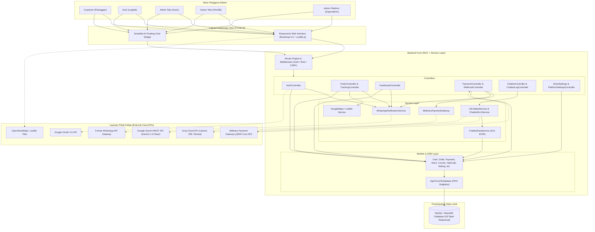

---

## 4. DESAIN BASIS DATA (DATABASE DESIGN)

### 4.1 Ringkasan Struktur 28 Tabel Basis Data
Tabel 4.1 merangkum seluruh tabel yang terdefinisi pada skema database aktual `db_laundry_marketplace`.

**Tabel 4.1 Daftar Tabel Basis Data SmartLaundry Pro**

| No | Nama Tabel | Deskripsi Fungsional Tabel | Engine |
|---|---|---|---|
| 1 | `roles` | Menyimpan master data 6 peran pengguna sistem (`owner_platform` s/d `customer`). | InnoDB |
| 2 | `users` | Data akun pengguna, kredensial password hash, kontak, Google ID, dan status aktif. | InnoDB |
| 3 | `addresses` | Buku alamat pengguna dan toko lengkap dengan penanda titik latitude & longitude. | InnoDB |
| 4 | `stores` | Profil outlet toko laundry (pemilik, nama, slug, jam kerja, rating, status verifikasi). | InnoDB |
| 5 | `store_admins` | Tabel relasi asosiasi staf/kasir terhadap toko tempat mereka bertugas. | InnoDB |
| 6 | `laundry_services` | Katalog paket layanan laundry per toko (satuan/kiloan, tarif dasar, durasi). | InnoDB |
| 7 | `couriers` | Profil kurir (toko induk, jenis kendaraan, nomor plat polisi, ketersediaan, GPS). | InnoDB |
| 8 | `orders` | Entitas induk pesanan laundry (kode order, status tahapan pengerjaan, total biaya). | InnoDB |
| 9 | `order_items` | Rincian layanan yang dipilih dalam suatu pesanan beserta kuantitas dan subtotal. | InnoDB |
| 10 | `laundry_details` | Rincian timbangan aktual (kg) pakaian saat diterima di kasir toko. | InnoDB |
| 11 | `payments` | Riwayat transaksi pembayaran, tipe bayar (QRIS/Cash), status bayar, payload QRIS. | InnoDB |
| 12 | `courier_locations` | Log histori rekam jejak koordinat GPS kurir selama perjalanan logistik. | InnoDB |
| 13 | `notifications` | Notifikasi in-app untuk pengguna sistem. | InnoDB |
| 14 | `order_status_histories` | Jejak audit (*audit trail*) perubahan kronologis status cucian dan aktor pengubah. | InnoDB |
| 15 | `courier_task_offers` | Data penawaran tugas jemput/antar ke kurir beserta status terima/tolak/kadaluarsa. | InnoDB |
| 16 | `whatsapp_logs` | Outbox log pengiriman pesan WhatsApp (kategori, tujuan, pesan, dedupe key, status). | InnoDB |
| 17 | `reviews` | Ulasan bintang (1-5) dan review tekstual pelanggan terhadap layanan outlet toko. | InnoDB |
| 18 | `chatbot_messages` | Log histori obrolan AI antara pengguna dan SmartBot beserta latensi & token. | InnoDB |
| 19 | `chatbot_knowledge` | Basis data pengetahuan/FAQ untuk pencarian informasi semantik AI. | InnoDB |
| 20 | `chatbot_data_access_logs` | Log audit eksekusi query data internal oleh chatbot (pencegahan kebocoran data). | InnoDB |
| 21 | `store_expenses` | Catatan beban pengeluaran operasional toko (listrik, deterjen, sewa, gaji). | InnoDB |
| 22 | `settings` | Konfigurasi key-value platform global (nama app, gateway switch, backup AI models). | InnoDB |
| 23 | `setting_audit_logs` | Jejak audit perubahan pengaturan sistem oleh administrator platform. | InnoDB |
| 24 | `store_settings` | Konfigurasi pengaturan khusus per outlet toko laundry. | InnoDB |
| 25 | `otp_codes` | Kode OTP verifikasi registrasi dan pembayaran (hash BCRYPT, masa berlaku, order_id). | InnoDB |
| 26 | `whatsapp_notification_settings` | Pengaturan saklar event dan template WhatsApp per scope GLOBAL / STORE. | InnoDB |
| 27 | `whatsapp_notification_recipients`| Daftar nomor telepon penerima notifikasi peringatan staf toko / admin. | InnoDB |
| 28 | `whatsapp_notification_templates` | Template multi-pesan dinamis per event penjemputan atau pengantaran. | InnoDB |

### 4.2 Kamus Data Struktur Tabel Utama
Berikut adalah rincian kolom kunci pada tabel-tabel transaksional utama:

* **Tabel `orders`**:
  - `id`: `INT UNSIGNED AUTO_INCREMENT PRIMARY KEY`
  - `order_code`: `VARCHAR(50) NOT NULL UNIQUE` (Format: `LND-YYYYMMDD-XXXX`)
  - `customer_id`: `INT UNSIGNED NOT NULL` (FK ke `users.id`)
  - `store_id`: `INT UNSIGNED NOT NULL` (FK ke `stores.id`)
  - `courier_id`: `INT UNSIGNED NULL` (FK ke `users.id`)
  - `pickup_address_id`: `INT UNSIGNED NOT NULL` (FK ke `addresses.id`)
  - `delivery_address_id`: `INT UNSIGNED NULL` (FK ke `addresses.id`)
  - `status`: `ENUM('MENUNGGU_KONFIRMASI', 'MENUNGGU_KURIR', 'KURIR_MENUJU_LOKASI', 'LAUNDRY_DIJEMPUT', 'DALAM_PERJALANAN_KE_TOKO', 'SAMPAI_DI_TOKO', 'SEDANG_DITIMBANG', 'MENUNGGU_PEMBAYARAN', 'PEMBAYARAN_BERHASIL', 'PEMBAYARAN_DIKONFIRMASI', 'SEDANG_DICUCI', 'SEDANG_DIPROSES', 'SIAP_DIANTAR', 'KURIR_MENGANTAR', 'LAUNDRY_DIANTAR', 'SELESAI', 'DIBATALKAN', 'PEMBAYARAN_KADALUARSA', 'PROSES_PENGEMBALIAN', 'PENGEMBALIAN_SELESAI')`
  - `payment_method`: `ENUM('ONLINE_QRIS', 'CASH') DEFAULT 'ONLINE_QRIS'`
  - `payment_status`: `ENUM('UNPAID', 'PAID', 'EXPIRED', 'REFUNDED') DEFAULT 'UNPAID'`
  - `total_price`: `DECIMAL(12,2) DEFAULT 0.00`
  - `payment_expired_at`: `DATETIME NULL` (Batas waktu 60 menit QRIS)

* **Tabel `payments`**:
  - `id`: `INT UNSIGNED AUTO_INCREMENT PRIMARY KEY`
  - `order_id`: `INT UNSIGNED NOT NULL` (FK ke `orders.id`)
  - `invoice_number`: `VARCHAR(50) NOT NULL UNIQUE`
  - `payment_type`: `VARCHAR(30) NOT NULL` (e.g. `qris`, `cash`)
  - `gross_amount`: `DECIMAL(12,2) NOT NULL`
  - `transaction_status`: `VARCHAR(30) NOT NULL DEFAULT 'PENDING'`
  - `qris_payload`: `TEXT NULL` (String QR code payload)
  - `qris_image_url`: `TEXT NULL` (URL gambar QRIS)
  - `expired_at`: `DATETIME NULL`

* **Tabel `otp_codes`**:
  - `id`: `INT UNSIGNED AUTO_INCREMENT PRIMARY KEY`
  - `user_id`: `INT UNSIGNED NOT NULL` (FK ke `users.id`)
  - `order_id`: `INT UNSIGNED NULL` (FK ke `orders.id` — ditambah pada Migrasi 011)
  - `otp_hash`: `VARCHAR(255) NOT NULL` (Hash BCRYPT kode 6-digit)
  - `channel`: `ENUM('WHATSAPP', 'EMAIL') NOT NULL`
  - `purpose`: `VARCHAR(50) NOT NULL DEFAULT 'REGISTER'`
  - `expired_at`: `DATETIME NOT NULL`
  - `is_used`: `TINYINT(1) DEFAULT 0`
  - `attempts`: `INT DEFAULT 0`

### 4.3 Entity Relationship Diagram (ERD Aktual)
Diagram relasi entitas pada Gambar 4.1 merefleksikan seluruh Foreign Key dan relasi kardinalitas yang terpasang pada skema database aktual.

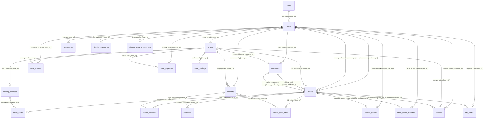

---

## 5. UML USE CASE DIAGRAM

Gambar 5.1 dan 5.2 mendokumentasikan pemetaan fungsional use case terhadap seluruh aktor pengguna dan sistem eksternal.

### 5.1 Use Case Diagram Platform & Store Management

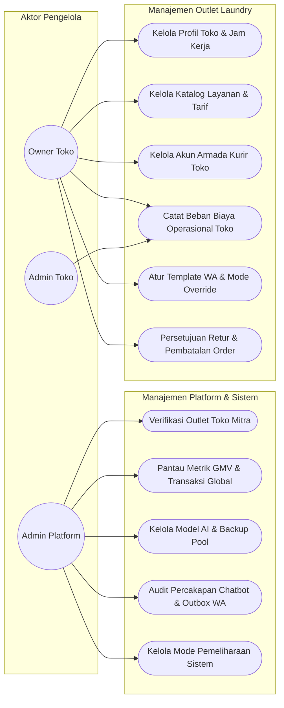

### 5.2 Use Case Diagram Order, Logistics & Customer Interaction

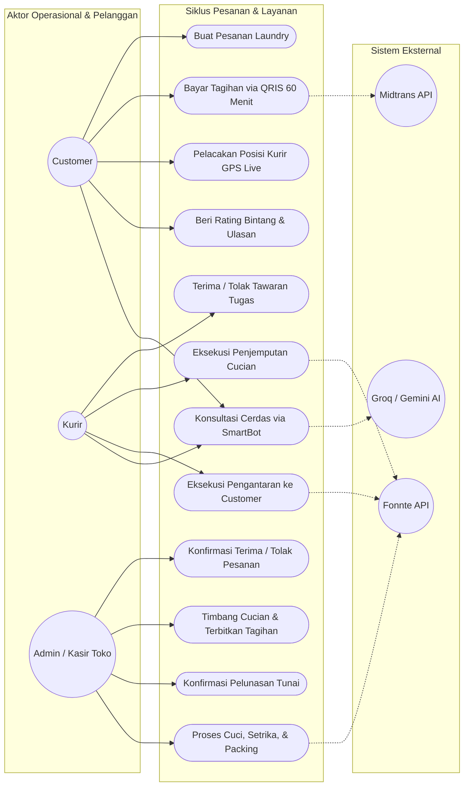

---

## 6. ACTIVITY DIAGRAM

### 6.1 Aktivitas Registrasi & Login Pengguna
Diagram aktivitas pada Gambar 6.1 merinci alur pendaftaran customer baru, penerbitan OTP, hingga masuk sistem.

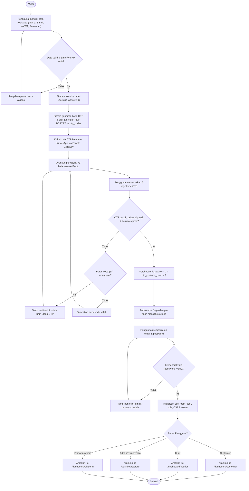

### 6.2 Aktivitas Pemesanan Laundry oleh Customer
Diagram aktivitas pada Gambar 6.2 merinci tahapan pembuatan pesanan oleh customer.

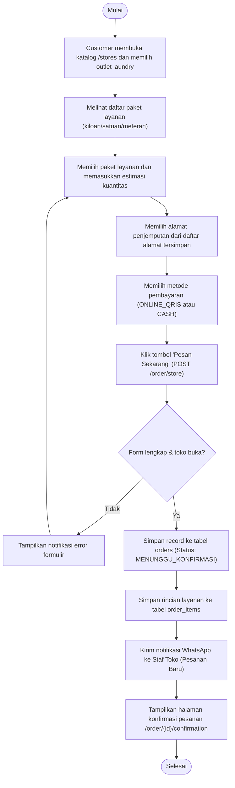

### 6.3 Aktivitas Penimbangan & Pembayaran QRIS / Tunai
Diagram aktivitas pada Gambar 6.3 merinci penimbangan pakaian di outlet dan pelunasan tagihan.

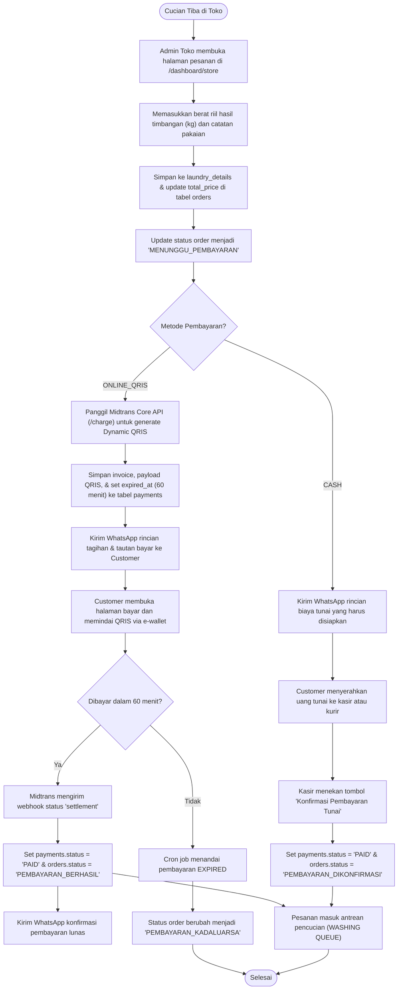

### 6.4 Aktivitas Pengantaran Laundry ke Customer
Diagram aktivitas pada Gambar 6.4 merinci penugasan kurir hingga penyerahan pakaian bersih ke tangan pelanggan.

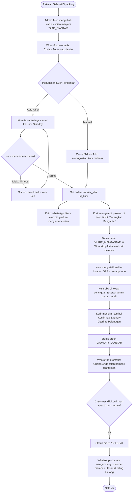

---

## 7. SEQUENCE DIAGRAM

### 7.1 Sequence Diagram: Otentikasi & Login Pengguna
Diagram sequence pada Gambar 7.1 menggambarkan verifikasi kredensial pengguna dan pengalihan ke dashboard berbasis peran.

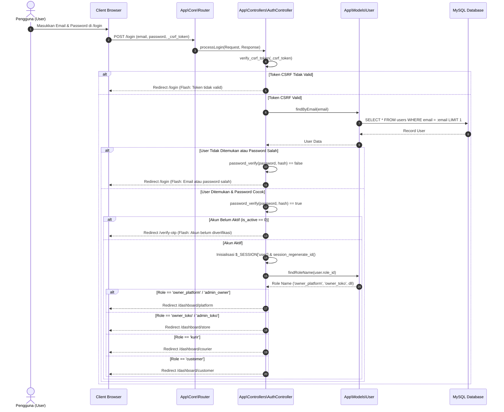

### 7.2 Sequence Diagram: Pembayaran QRIS Midtrans & Countdown 60 Menit
Diagram sequence pada Gambar 7.2 mendokumentasikan penerbitan QRIS melalui Core API Midtrans.

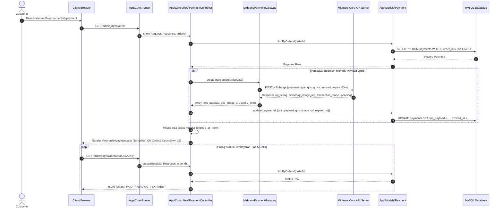

### 7.3 Sequence Diagram: Penanganan Webhook Pembayaran Midtrans
Diagram sequence pada Gambar 7.3 merinci verifikasi tanda tangan digital saat Midtrans mentransmisikan status pelunasan.

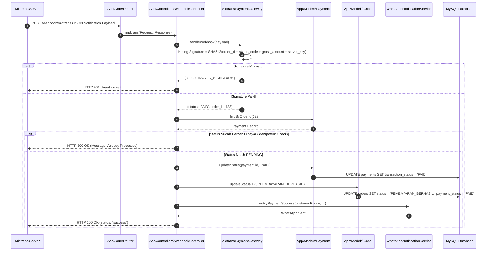

### 7.4 Sequence Diagram: Konsultasi AI Multi-Provider (Groq / Gemini / NLU)
Diagram sequence pada Gambar 7.4 menggambarkan orkestrasi konsultasi asisten virtual SmartBot.

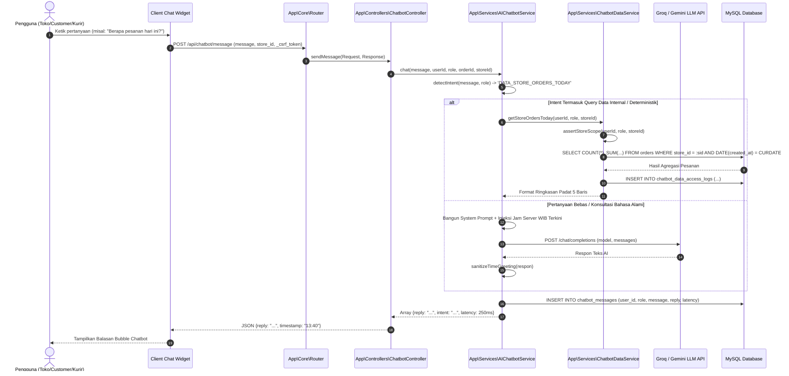

---

## 8. DESAIN MODUL PERANGKAT LUNAK

### 8.1 Modul Controllers (`app/Controllers`)
Modul controller bertanggung jawab menangani alur HTTP request:
* **`AuthController`**: Menangani otentikasi akun, hash password BCRYPT, pendaftaran customer, simulasi/live Google OAuth, dan verifikasi OTP registrasi.
* **`DashboardController`**: Mengelola rendering dashboard spesifik peran (`platform`, `store`, `courier`, `customer`), aksi transisi status cuci kasir, serta aksi logistik kurir.
* **`OrderController`**: Menangani pembuatan pesanan baru, pemilihan multi-layanan, pemilihan alamat, dan halaman konfirmasi pesanan.
* **`PaymentController`**: Menangani pembuatan invoice, pemanggilan Core API QRIS Midtrans, timer 60 menit, cek status AJAX, dan konfirmasi tunai.
* **`WebhookController`**: Menerima dan memverifikasi notifikasi HTTP POST webhook dari Midtrans dengan enkripsi SHA-512.
* **`TrackingController`**: Menangani pembaruan koordinat GPS kurir secara berkala dan menyajikan data koordinat rute untuk peta Leaflet.
* **`CourierAssignmentController`**: Mengelola sistem distribusi tawaran tugas (`courier_task_offers`) serta aksi terima/tolak kurir.
* **`ServiceController`**: Menangani operasi CRUD katalog layanan laundry outlet toko mitra.
* **`CourierManagementController`**: Menangani pendaftaran dan administrasi armada kurir toko laundry.
* **`StoreExpenseController`**: Menangani pencatatan beban biaya operasional toko (listrik, deterjen, air, gaji).
* **`WhatsAppSettingsController`**: Menangani konfigurasi template pesan WhatsApp, daftar nomor penerima tambahan, dan saklar mode override nomor pengujian.
* **`ChatbotController` & `ChatbotLogController`**: Mengelola endpoint API percakapan asisten SmartBot, riwayat pesan, dan ekspor jejak audit percakapan.
* **`PlatformSettingsController`**: Menangani pengaturan global platform, saklar mode pemeliharaan, serta pengelolaan model cadangan AI (*Backup Agent Pool*).

### 8.2 Modul Models (`app/Models`)
Modul model mengabstraksi struktur dan manipulasi data pada basis data:
* **`User`**: Operasi CRUD pengguna, verifikasi email/telepon, pencarian berdasarkan Google ID.
* **`Order`**: Mengelola siklus pesanan, perhitungan total harga, filter pesanan per toko dan per customer, serta statistik antrean.
* **`Payment`**: Mengelola record tagihan, payload QRIS, status transaksi, dan masa kadaluarsa.
* **`Store`**: Mengelola profil outlet laundry, status verifikasi platform, kalkulasi agregat rating bintang, dan ringkasan metrik toko.
* **`Courier`**: Mengelola ketersediaan armada, nomor plat kendaraan, dan koordinat terakhir.
* **`OtpCode`**: Menghasilkan token OTP acak, verifikasi hash BCRYPT, pencatatan batas percobaan, dan pencegahan penggunaan ulang kode.
* **`WhatsAppLog`**: Merekam seluruh jejak pengiriman pesan WhatsApp ke tabel outbox log beserta kategori dan status gateway.
* **`WhatsAppNotificationSetting` & `WhatsAppNotificationTemplate`**: Mengelola konfigurasi template pesan dan saklar event notifikasi.
* **`Setting`**: Mengelola pasangan kunci-nilai konfigurasi platform dan audit perubahannya.

### 8.3 Modul Services (`app/Services`)
Modul service mengisolasi logika integrasi pihak ketiga dan aturan bisnis independen:
* **`AIChatbotService`**: Orkestrator percakapan AI yang mendukung Groq Cloud, Google Gemini, OpenAI, dan Offline NLU beserta penanganan failover agen cadangan.
* **`ChatbotDataService`**: Mesin penarikan data database read-only yang aman dari IDOR dan SQL Injection untuk kebutuhan analitik AI.
* **`ChatbotNLUService`**: Ekstraktor intent dan penyedia sapaan waktu Indonesia presisi berbasis zona waktu Asia/Jakarta (WIB).
* **`WhatsAppNotificationService`**: Service pengiriman pesan WhatsApp multi-kategori dan multi-message melalui Fonnte API Gateway.
* **`MidtransPaymentGateway`**: Service pembuatan transaksi QRIS dinamis dan verifikasi signature SHA-512 webhook Midtrans.
* **`PlatformStatsService` & `MetricsService`**: Service kalkulasi agregasi finansial (GMV, omzet bersih, komisi) dan metrik operasional.

### 8.4 Modul Views & Layouts (`app/Views`)
Menyediakan antarmuka visual berbasis PHP:
* `layouts/main.php`: Template master HTML yang menyatukan header, navbar navigasi dinamis berbasis role, penampung flash message, kontainer konten utama, footer, dan injeksi widget SmartBot.
* `partials/chatbot_widget.php`: Komponen antarmuka obrolan mengambang (*floating widget*) cerdas yang menyapa pengguna sesuai jam aktif dan menyajikan chip pertanyaan cepat.

### 8.5 Modul Routing & Middlewares
* Rute didaftarkan secara deklaratif pada file `index.php`.
* Middleware gerbang keamanan dieksekusi secara berurutan:
  - `auth`: Memastikan session `$_SESSION['user']` aktif.
  - `role:role1,role2`: Memastikan peran pengguna login terdaftar dalam daftar peran yang diizinkan untuk mengakses rute tersebut.

---

## 9. DESAIN KEAMANAN SISTEM (SECURITY DESIGN)

### 9.1 Manajemen Sesi & Otentikasi
* Sesi login dikelola menggunakan native PHP Session dengan pengamanan cookie `httponly = true` untuk mencegah pencurian sesi melalui skrip jahat JavaScript (*XSS session hijacking*).
* Saat pengguna berhasil login, sistem memanggil `session_regenerate_id(true)` untuk mencegah serangan fiksasi sesi (*Session Fixation*).
* Kata sandi dienkripsi menggunakan algoritma `PASSWORD_BCRYPT` standar industri dengan salt otomatis.

### 9.2 Otorisasi Peran (RBAC) & Pencegahan IDOR
* Hak akses terhadap URL dilindungi oleh `RoleMiddleware`.
* **Pencegahan IDOR pada Data Toko**: Pada controller toko (`DashboardController`, `ServiceController`, `CourierManagementController`), sistem selalu memvalidasi kepemilikan toko menggunakan `Store::findForUser(auth_user()['id'])`. Jika pengguna mencoba memanipulasi parameter ID pesanan milik toko lain, sistem langsung menolak dengan status HTTP 403 Forbidden.

### 9.3 Sanitasi Masukan & Pencegahan SQLi / XSS / CSRF
* **SQL Injection**: Dieliminasi 100% dengan keharusan penggunaan *PDO Prepared Statements* pada seluruh fungsi di kelas `Model`.
* **Cross-Site Scripting (XSS)**: Seluruh data luaran yang dicetak ke dokumen HTML dienkapsulasi menggunakan fungsi `e()` atau `htmlspecialchars($str, ENT_QUOTES, 'UTF-8')`.
* **Cross-Site Request Forgery (CSRF)**: Seluruh aksi mutasi data (POST) divalidasi menggunakan token acak 64-karakter hex yang disimpan di sesi pengguna.

### 9.4 Keamanan Pembayaran & Verifikasi Signature Webhook
* Transaksi QRIS Midtrans menggunakan nominal pasti yang dikunci dari backend (tabel `orders.total_price`).
* Webhook Midtrans wajib lolos uji tanda tangan kriptografi SHA-512:
  $$\text{Signature} = \text{hash}('sha512', \text{order\_id} + \text{status\_code} + \text{gross\_amount} + \text{server\_key})$$
  Jika tanda tangan tidak cocok persis dengan header yang dikirim Midtrans, payload ditolak dengan HTTP 401 Unauthorized.

### 9.5 Perlindungan Kriptografi OTP & Penyamaran Log
* Kode OTP numerik 6-digit tidak pernah disimpan dalam format teks polos di database; sistem menyimpan nilai `password_hash($otp, PASSWORD_BCRYPT)` pada tabel `otp_codes`.
* Verifikasi dilakukan menggunakan `password_verify($inputOtp, $otpHash)`.
* Pada tabel outbox `whatsapp_logs`, kode OTP disamarkan (misal: `12****`) agar tidak terbaca oleh staf yang memiliki akses ke database log.

### 9.6 Manajemen Kunci Rahasia API
Seluruh kunci rahasia (`MIDTRANS_SERVER_KEY`, `FONNTE_TOKEN`, `AI_API_KEY`, `APP_KEY`, `DB_PASSWORD`) diisolasi pada berkas `.env` dan diabaikan dari pelacakan repositori publik Git melalui berkas `.gitignore`.

---

## 10. DESAIN ANTARMUKA PENGGUNA (UI DESIGN)

Bagian ini mendokumentasikan tata letak konseptual (*wireframe layout*) halaman-halaman utama aplikasi SmartLaundry Pro.

### 10.1 Rancangan Antarmuka Halaman Utama (Landing Page)
Menyajikan hero section, fitur unggulan marketplace, serta daftar outlet laundry terdekat dengan rating bintang.

```
+-----------------------------------------------------------------------------------+
|  [Logo] SmartLaundry Pro     Beranda   Outlet Toko   Tentang   [Masuk] [Daftar]   |
+-----------------------------------------------------------------------------------+
|                                                                                   |
|     SOLUSI LAUNDRY MODERN DENGAN PENJEMPUTAN & KECERDASAN BUATAN                  |
|     Pakaian bersih, wangi, dan rapi tanpa perlu keluar rumah. Antar jemput        |
|     terlacak GPS dan bayar mudah via QRIS.                                        |
|                                                                                   |
|     [ Cari Laundry Terdekat ]              [ Pelajari Cara Pesan ]               |
|                                                                                   |
+-----------------------------------------------------------------------------------+
|  OUTLET LAUNDRY MITRA PILIHAN                                                     |
|  +-------------------------+ +-------------------------+ +----------------------+ |
|  | [Foto] CleanWash Outlet | | [Foto] FreshSoft Laundry| | [Foto] Kilat Express | |
|  | Rating: ★ 4.9 (120 rev) | | Rating: ★ 4.8 (85 rev)  | | Rating: ★ 5.0 (40)   | |
|  | Cuci Kiloan: Rp 7.000/kg| | Cuci Kiloan: Rp 8.000/kg| | Express: Rp 12.000/kg| |
|  | [ Pesan Sekarang ]      | | [ Pesan Sekarang ]      | | [ Pesan Sekarang ]   | |
|  +-------------------------+ +-------------------------+ +----------------------+ |
+-----------------------------------------------------------------------------------+
|  (C) 2026 SmartLaundry Pro Marketplace. Hak Cipta Dilindungi.                     |
+-----------------------------------------------------------------------------------+
```

### 10.2 Rancangan Antarmuka Dashboard Toko & Antrean Kasir
Halaman operasional harian bagi Admin Toko/Kasir untuk menimbang dan memproses cucian.

```
+-----------------------------------------------------------------------------------+
|  SmartLaundry Toko   | Outlet: CleanWash Laundry (ID: 1)         [Fajar / Kasir v] |
+-----------------------------------------------------------------------------------+
|  [ STATISTIK HARI INI ]                                                           |
|  +--------------------+ +--------------------+ +--------------------------------+ |
|  | PESANAN HARI INI   | | ANTREAN TIMBANG    | | DALAM PENCUCIAN                | |
|  | 5 Pesanan Masuk    | | 3 Cucian Menunggu  | | 4 Pakaian Sedang Dicuci/Setrika| |
|  +--------------------+ +--------------------+ +--------------------------------+ |
|                                                                                   |
|  ANTREAN PENIMBANGAN CUCIAN (WEIGHING QUEUE)                                      |
|  +------------------------------------------------------------------------------+ |
|  | Kode Order    | Pelanggan      | Layanan Pilihan  | Input Berat Riil | Aksi     | |
|  |---------------+----------------+------------------+------------------+----------| |
|  | LND-20261115-1| Ani Rahmawati  | Cuci + Setrika   | [ 3.5 ] Kg       | [Timbang]| |
|  | LND-20261115-2| Budi Santoso   | Cuci Selimut     | [ 5.0 ] Kg       | [Timbang]| |
|  +------------------------------------------------------------------------------+ |
|                                                                                   |
|  ANTREAN PROSES CUCI & PACKING                                                    |
|  +------------------------------------------------------------------------------+ |
|  | LND-20261115-0| Deni F. (4 Kg) | Status: [Sedang Dicuci v] | [Kirim WA Status]| |
|  +------------------------------------------------------------------------------+ |
+--------------------------------------------------------------------+--------------+
                                                                     | [SmartBot AI]|
                                                                     +--------------+
```

### 10.3 Rancangan Antarmuka Tagihan Pembayaran QRIS Midtrans
Halaman tagihan dinamis dengan kode QRIS dan waktu hitung mundur 60 menit.

```
+-----------------------------------------------------------------------------------+
|                           TAGIHAN PEMBAYARAN LAUNDRY                              |
|                              No: INV-20261115-00437                               |
+-----------------------------------------------------------------------------------+
|                                                                                   |
|     TOTAL TAGIHAN:                                                                |
|     Rp 28.000                                                                     |
|                                                                                   |
|     SISA WAKTU PEMBAYARAN:                                                        |
|     [  00 : 54 : 22  ]  (Batas Waktu: 12:45 WIB)                                  |
|                                                                                   |
|     +-----------------------------------------+                                   |
|     |                                         |                                   |
|     |           [ GAMBAR KODE QRIS ]          |                                   |
|     |        Pindai menggunakan GoPay,        |                                   |
|     |        OVO, Dana, ShopeePay, atau BCA   |                                   |
|     |                                         |                                   |
|     +-----------------------------------------+                                   |
|                                                                                   |
|     [ Petunjuk Pembayaran ]           [ Cek Status Pembayaran ]                   |
|                                                                                   |
+-----------------------------------------------------------------------------------+
```

### 10.4 Rancangan Antarmuka Widget Asisten AI (SmartBot)
Widget obrolan mengambang yang menyesuaikan peran dan jam server Indonesia.

```
+-----------------------------------------------------------+
|  (•) SmartBot — Asisten Resmi SmartLaundry         [—] [X]|
|      Online • Menyesuaikan Waktu Asia/Jakarta (WIB)       |
+-----------------------------------------------------------+
|  [Chip: Berapa pesanan hari ini?] [Chip: Omzet bulan ini?]|
+-----------------------------------------------------------+
|                                                           |
|  (Bot) Selamat siang, Fajar!                              |
|        Saya SmartBot, asisten resmi SmartLaundry.         |
|        Ada yang bisa saya bantu terkait operasional toko? |
|                                                    13:30  |
|                                                           |
|                            (User) Berapa pesanan hari ini?|
|                                                    13:31  |
|                                                           |
|  (Bot) 📦 Pesanan Hari Ini (17 Nov 2026):                 |
|        • Total: 5 pesanan                                 |
|        • Perlu Konfirmasi: 1                              |
|        • Antrean Timbang: 2                               |
|        • Dalam Pencucian: 1                               |
|        • Selesai: 1                                       |
|                                                    13:31  |
|                                                           |
+-----------------------------------------------------------+
|  [ Ketik pertanyaan seputar cucian atau toko...   ] [Kirim|
+-----------------------------------------------------------+
```

---

## 11. DESAIN INTEGRASI LAYANAN EKSTERNAL

### 11.1 Integrasi Mesin AI (Groq Cloud & Google Gemini)
* **Pola Integrasi**: HTTP REST Client via PHP cURL.
* **Protokol**: HTTPS POST JSON payload.
* **Mekanisme Failover Multi-Provider**:
  1. Sistem memeriksa konfigurasi `ai_provider` pada tabel `settings` atau `.env`.
  2. Query deterministik (identitas bot, kapabilitas, sapaan, data transaksi internal) diselesaikan secara lokal oleh `ChatbotNLUService` dan `ChatbotDataService`.
  3. Query percakapan bebas diarahkan ke endpoint penyedia aktif:
     - Groq: `https://api.groq.com/openai/v1/chat/completions` dengan otorisasi `Bearer {API_KEY}`.
     - Gemini: `https://generativelanguage.googleapis.com/v1beta/models/{model}:generateContent?key={API_KEY}`.
  4. Jika pemanggilan gagal (HTTP 429 atau cURL error), sistem mengiterasi model cadangan pada `ai_backup_models`. Jika seluruhnya gagal, sistem beralih ke `handleMockResponse()` tanpa memicu error visual pada pengguna.

### 11.2 Integrasi Gateway Pembayaran (Midtrans Core API)
* **Pola Integrasi**: Server-to-Server REST API Charge & Asynchronous Webhook Callback.
* **Endpoint Transaksi**: `POST https://api.sandbox.midtrans.com/v2/charge` (Sandbox) atau `https://api.midtrans.com/v2/charge` (Production).
* **Otorisasi**: Header HTTP `Authorization: Basic base64(SERVER_KEY + ":")`.
* **Parameter Payload**:
  ```json
  {
    "payment_type": "qris",
    "transaction_details": {
      "order_id": "MD_QRIS_437_1763354400",
      "gross_amount": 28000
    },
    "custom_expiry": {
      "expiry_duration": 60,
      "unit": "minute"
    }
  }
  ```
* **Webhook Handler**: Menerima JSON dari Midtrans di `/webhook/midtrans`, memverifikasi signature SHA-512, dan mengeksekusi transisi status pesanan secara idempoten.

### 11.3 Integrasi Gateway Notifikasi (Fonnte WhatsApp API)
* **Pola Integrasi**: HTTP POST Form-Data Client via cURL transport (`App\Services\WhatsApp\FonnteWhatsAppGateway`).
* **Endpoint Pengiriman**: `POST https://api.fonnte.com/send`.
* **Otorisasi**: Header HTTP `Authorization: {FONNTE_TOKEN}` (tanpa kata *Bearer* sesuai spesifikasi Fonnte).
* **Fitur Tambahan**: Pengecekan status konektivitas perangkat Android via endpoint `POST https://api.fonnte.com/device`.
* **Mode Override Pengujian**: Pengalihan nomor tujuan secara terpusat pada service layer jika saklar testing `wa_override_enabled = 1` aktif.

### 11.4 Integrasi Layanan Geospasial (Leaflet.js & OpenStreetMap)
* **Pola Integrasi**: Client-Side Library Rendering & AJAX Polling.
* **Mekanisme**:
  1. Halaman web memuat skrip `leaflet.js` dan stylesheet `leaflet.css`.
  2. Titik koordinat toko dan alamat pelanggan diplot sebagai marker statis.
  3. Posisi kurir diplot sebagai marker bergerak yang diperbarui posisinya setiap 5 detik dengan menarik data koordinat dari endpoint backend `/tracking/{order_code}/live-location`.

### 11.5 Integrasi Otentikasi Pihak Ketiga (Google OAuth 2.0)
* **Pola Integrasi**: OAuth 2.0 Authorization Code Grant Flow.
* **Endpoint Google**: `https://accounts.google.com/o/oauth2/v2/auth`.
* **Scope**: `email profile openid`.
* **Mekanisme Dual-Mode**: Jika kredensial `GOOGLE_CLIENT_ID` dan `GOOGLE_CLIENT_SECRET` belum diisi pada `.env`, sistem secara otomatis mengalihkan alur ke *Simulated Google OAuth* untuk keperluan demonstrasi pengujian lokal.

---

## 12. KESIMPULAN

Dokumen Desain Perangkat Lunak (*Software Design Document* — SDD) ini mendokumentasikan secara rinci arsitektur perangkat lunak, perancangan modul, struktur basis data, alur UML, pertimbangan keamanan, rancangan antarmuka, dan integrasi pihak ketiga aplikasi **SmartLaundry Pro**.

Perancangan yang terdokumentasi dalam berkas ini mencerminkan implementasi kode program yang sebenarnya (*as-built software design*), telah diverifikasi melalui audit komprehensif, dan telah lulus 100% pada seluruh pengujian regresi resmi. Dengan demikian, dokumen ini memenuhi standar akademik rekayasa perangkat lunak dan siap dijadikan bahan presentasi, demonstrasi teknis, serta evaluasi pada Ujian Akhir Semester (UAS).

---

*Dokumen ini disusun sebagai bukti pemenuhan dokumentasi akademik mata kuliah Rekayasa Perangkat Lunak (RPL).*
