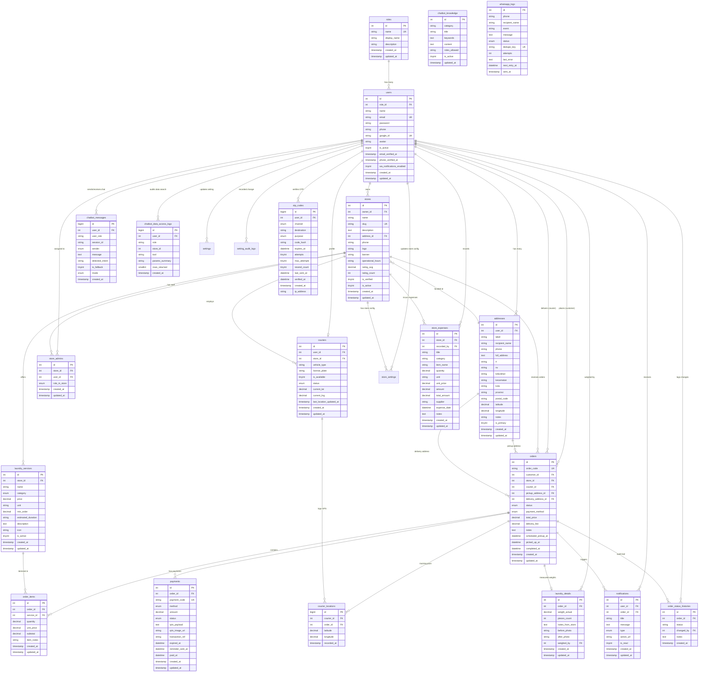

# Entity Relationship Diagram (ERD) - SmartLaundry AI Marketplace

Dokumen ini mendefinisikan desain skema database relasional (25 Tabel) untuk sistem **Marketplace Laundry Berbasis Web dengan Integrasi AI**.

---

## 1. Visualisasi ERD (Mermaid Diagram)

---

## 2. Penjelasan Relasi dan Kardinalitas

| Hubungan Relasi | Kardinalitas | Tipe Constraint (FK) | Penjelasan |
| :--- | :--- | :--- | :--- |
| `users` &rarr; `otp_codes` | 1 to Many (1:N) | `ON UPDATE CASCADE ON DELETE CASCADE` | Kode verifikasi OTP WhatsApp & Email untuk registrasi customer baru dan perubahan nomor WhatsApp. |
| :--- | :--- | :--- | :--- |
| `roles` &rarr; `users` | 1 to Many (1:N) | `ON UPDATE CASCADE ON DELETE RESTRICT` | Satu role dapat dimiliki oleh banyak user. Role tidak boleh dihapus jika masih ada user aktif. |
| `users` &rarr; `addresses` | 1 to Many (1:N) | `ON UPDATE CASCADE ON DELETE CASCADE` | Satu customer dapat menyimpan banyak alamat penjemputan (Rumah, Kantor, Kos). |
| `users` &rarr; `stores` | 1 to Many (1:N) | `ON UPDATE CASCADE ON DELETE RESTRICT` | User dengan role `owner_toko` memiliki satu atau lebih cabang toko laundry. |
| `stores` &rarr; `store_admins` | 1 to Many (1:N) | `ON UPDATE CASCADE ON DELETE CASCADE` | Tabel pivot relasi multi-admin/kasir yang ditugaskan di toko tertentu. |
| `stores` &rarr; `laundry_services` | 1 to Many (1:N) | `ON UPDATE CASCADE ON DELETE CASCADE` | Setiap toko mendefinisikan menu layanan dan tarif masing-masing. |
| `users` &rarr; `couriers` | 1 to 1 (1:1) | `ON UPDATE CASCADE ON DELETE CASCADE` | Data profil dan kendaraan spesifik untuk user ber-role kurir. |
| `users` (Customer) &rarr; `orders` | 1 to Many (1:N) | `ON UPDATE CASCADE ON DELETE RESTRICT` | Customer dapat membuat banyak pesanan laundry. |
| `stores` &rarr; `orders` | 1 to Many (1:N) | `ON UPDATE CASCADE ON DELETE RESTRICT` | Toko menerima banyak pesanan masuk. |
| `stores` &rarr; `store_expenses` | 1 to Many (1:N) | `ON UPDATE CASCADE ON DELETE CASCADE` | Catatan pengeluaran operasional toko (bahan baku, listrik, plastik packing, dll). |
| `orders` &rarr; `order_items` | 1 to Many (1:N) | `ON UPDATE CASCADE ON DELETE CASCADE` | Rincian paket layanan dalam satu order. |
| `orders` &rarr; `laundry_details` | 1 to 1 (1:1) | `ON UPDATE CASCADE ON DELETE CASCADE` | Catatan penimbangan berat aktual (kg), helai pakaian, dan foto sebelum/sesudah. |
| `orders` &rarr; `payments` | 1 to Many (1:N) | `ON UPDATE CASCADE ON DELETE CASCADE` | Rekam pembayaran invoice (QRIS / Cash), timer batas 1 jam, dan status lunas. |
| `couriers` &rarr; `courier_locations`| 1 to Many (1:N) | `ON UPDATE CASCADE ON DELETE CASCADE` | Rekam titik koordinat GPS real-time kurir selama penjemputan/pengantaran. |
| `orders` &rarr; `order_status_histories` | 1 to Many (1:N) | `ON UPDATE CASCADE ON DELETE CASCADE` | Audit log lengkap histori transisi status pesanan beserta pengguna yang mengubah. |
| `users` &rarr; `notifications` | 1 to Many (1:N) | `ON UPDATE CASCADE ON DELETE CASCADE` | Notifikasi in-app untuk pembaruan pesanan, kurir, atau pembayaran. |
| `users` &rarr; `chatbot_messages` | 1 to Many (1:N) | `ON UPDATE CASCADE ON DELETE CASCADE` | Log percakapan AI Chatbot per-user. Konten disamarkan (PII-masked) sebelum disimpan. Retensi otomatis 90 hari via cron. |
| `users` &rarr; `chatbot_data_access_logs` | 1 to Many (1:N) | `ON UPDATE CASCADE ON DELETE CASCADE` | Audit log setiap pemanggilan tool akses data database yang dilakukan chatbot per user. |
| `chatbot_knowledge` | Standalone | - | Basis pengetahuan sistem terindeks FULLTEXT untuk referensi chatbot lintas role. |
| `users` &rarr; `settings` | 1 to Many (1:N) | `ON UPDATE CASCADE ON DELETE SET NULL` | Konfigurasi sistem dinamis (Umum, Pembayaran, Refund, Kurir, Notifikasi, Chatbot, Keamanan, Mode Pemeliharaan). |
| `users` &rarr; `setting_audit_logs` | 1 to Many (1:N) | `ON UPDATE CASCADE ON DELETE SET NULL` | Audit trail riwayat seluruh modifikasi konfigurasi (nilai lama, baru, waktu, IP, user). |
| `stores` &rarr; `store_settings` | 1 to Many (1:N) | `ON UPDATE CASCADE ON DELETE CASCADE` | Pengaturan spesifik outlet toko (jam buka, status buka/tutup, WA toko, retur fee bearer). |

---

## 3. Daftar Nilai Terkontrol (ENUM Reference)

### 1. `orders.status` (18 Status Workflow Terintegrasi)
1. `MENUNGGU_KONFIRMASI` — Pesanan baru dibuat oleh customer.
2. `MENUNGGU_KURIR` — Pesanan dikonfirmasi toko, menunggu kurir ditugaskan.
3. `KURIR_MENUJU_LOKASI` — Kurir dalam perjalanan ke alamat penjemputan.
4. `LAUNDRY_DIJEMPUT` — Pakaian kotor telah diserahkan customer ke kurir.
5. `DALAM_PERJALANAN_KE_TOKO` — Kurir membawa pakaian menuju outlet toko.
6. `SAMPAI_DI_TOKO` — Cucian tiba di toko laundry.
7. `SEDANG_DITIMBANG` — Operator menimbang berat ril & menghitung tagihan.
8. `MENUNGGU_PEMBAYARAN` — Invoice diterbitkan (QRIS countdown 1 jam berjalan).
9. `PEMBAYARAN_BERHASIL` — Pembayaran QRIS/DP telah terverifikasi lunas.
10. `SEDANG_DICUCI` — Pakaian masuk tahap pencucian mesin.
11. `SEDANG_DIPROSES` — Pakaian dalam tahap pengeringan, setrika uap, & packing wangi.
12. `SIAP_DIANTAR` — Pakaian bersih siap dijemput kurir untuk pengantaran.
13. `KURIR_MENUJU_CUSTOMER` — Kurir dalam perjalanan mengantar cucian bersih ke rumah.
14. `LAUNDRY_DIANTAR` — Kurir telah mengantarkan cucian ke customer dan menunggu konfirmasi penerimaan.
15. `SELESAI` — Laundry diterima oleh customer (Selesai).
16. `PEMBAYARAN_KADALUARSA` — Batas waktu pembayaran QRIS 1 jam habis tanpa pelunasan.
17. `PROSES_PENGEMBALIAN` — Laundry tidak dibayar dan dijadwalkan kembali ke customer.
18. `DIBATALKAN` — Pesanan dibatalkan sesuai kebijakan sistem.

### 2. `payments.status`
- `PENDING` — Menunggu pembayaran (QRIS aktif).
- `PAID` — Lunas terverifikasi.
- `EXPIRED` — Melewati batas waktu 1 jam.
- `FAILED` — Transaksi gagal.
- `REFUNDED` — Dana dikembalikan.
- `CANCELLED` — Dibatalkan.

### 3. `couriers.status`
- `TERSEDIA` — Kurir standby siap menerima tugas penjemputan/pengantaran baru.
- `BERTUGAS` — Kurir sedang aktif di jalan menyelesaikan tugas.
- `OFFLINE` — Kurir tidak bertugas / istirahat.
